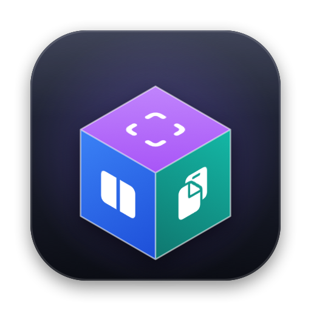

<p align="center"></p>

<p align="center"><a href="README.md">English</a> · <a href="README.ko.md">한국어</a> · <b>日本語</b> · <a href="README.zh-Hans.md">简体中文</a> · <a href="README.zh-Hant.md">繁體中文</a></p>

# PolyMac

> たくさんの Mac ツールを、ひとつの軽いメニューバーアプリに。
> Spectacle · TRex · Snipaste · AppCleaner · Maccy · Hazel ·「ターミナルで開く」を **ひとつの軽いアプリ** にまとめたオープンソースの macOS ユーティリティです。

> **現在のバージョン 1.1.0** — [GitHub Releases](https://github.com/beomzh/PolyMac/releases) からダウンロードするか、Homebrew でインストールできます。
> このページは要約版です。ショートカットの一覧、各機能の詳しい使い方、トラブルシューティングは [英語版 README](README.md) を参照してください。
> 一部の機能は韓国語のためのものです（韓国語ファイル名の修正など）。必要なければオフにしておけます。

## 機能

| モジュール | 機能 |
|---|---|
| **ウインドウ配置** | ショートカットでウインドウを ½、⅓、¼、最大化、次のディスプレイへ配置。端へドラッグして配置 |
| **キャプチャ・ピン** | 範囲・ウインドウ・画面全体のキャプチャ、**画面にピン留め**、後から編集できる注釈 |
| **テキスト認識（OCR）** | キャプチャをすぐにテキストにしてクリップボードへ。韓国語・英語・日本語・中国語、QR、URL、表の認識、オンデバイス翻訳 |
| **クリップボード履歴** | 検索、ピン留め、テキスト・画像・ファイル。パスワード管理アプリは自動で除外 |
| **Finder ツール** | 本当の `⌘X` カット、ここでターミナルを開く、エディタで開く、パスのコピー |
| **韓国語ファイル名の修正** | 分解された（NFD）韓国語ファイル名を自動で修正、Windows 向け zip |
| **ダウンロードの自動整理** | 条件とアクションを組み合わせたルールでファイルを移動・名前変更（初期設定はオフ） |
| **アプリのアンインストール** | アプリの残りファイルを場所・種類・確度ごとに表示してゴミ箱へ |

各機能は設定でオン・オフでき、オフにした機能はメモリに読み込まれません。

## 表示言語

設定 › 言語 で、システムの言語 / 한국어 / English / 日本語 / 简体中文 / 繁體中文 から選べます。すぐに反映されます。「システムの言語を使用」は macOS の最初の言語を使い、一覧にない言語の場合は英語になります。

テキスト認識（OCR）はまず韓国語・英語で読み、韓国語が見つからなければ日本語・中国語（簡体字・繁体字）を自動判別してもう一度読みます。

## インストール

### ダウンロード

[GitHub Releases](https://github.com/beomzh/PolyMac/releases) から `PolyMac-X.Y.Z.zip` と `PolyMac-X.Y.Z.zip.sha256` をダウンロードし、両方があるフォルダで改ざんがないか確認します:

```bash
shasum -a 256 -c PolyMac-X.Y.Z.zip.sha256
```

`OK` と表示されたら解凍し、`PolyMac.app` を `/Applications` に移動して開きます。

#### 初回起動がブロックされたとき

PolyMac は Apple の公証を受けておらず、独自の証明書（`PolyMac Beomzh`）で署名されています。そのため、ダウンロードしたものを初めて開くと **「"PolyMac"は壊れているため開けません」** と表示されます。ファイルは壊れていません。信頼できる場合は、ダイアログで **キャンセル** を押し（ゴミ箱に入れないでください）、ターミナルでダウンロードの印を外してから開き直します:

```bash
xattr -dr com.apple.quarantine /Applications/PolyMac.app
```

### Homebrew

```bash
brew tap beomzh/tap
```

```bash
brew trust --cask beomzh/tap/polymac
```

```bash
brew install --cask beomzh/tap/polymac
```

Homebrew でインストールすると、上の「壊れています」のダイアログは表示されません。

### アップデート

メニューバーの PolyMac アイコン › **アップデートを確認…** で GitHub の新しいバージョンをインストールします。PolyMac の署名鍵（EdDSA）が一致するものだけをインストールします。自動確認（1 日 1 回）は 設定 › 機能 › アップデート でオンにでき、初期設定はオフです。

## 権限

PolyMac は **オンにした機能に必要な権限だけ** を求めます。初回起動時にようこそガイドが開き、設定 › 権限 でいつでも状態を確認できます。

| 権限 | システム設定の場所 | 使う機能 |
|---|---|---|
| アクセシビリティ | プライバシーとセキュリティ › アクセシビリティ | ウインドウ配置、Finder の `⌘X`、自動ペースト |
| 画面とシステムオーディオの録音 | プライバシーとセキュリティ › 画面とシステムオーディオの録音 | キャプチャ、テキスト認識 |
| オートメーション › Finder | プライバシーとセキュリティ › オートメーション | ターミナルやエディタを開く、パスのコピー |
| ファイルとフォルダ | プライバシーとセキュリティ › ファイルとフォルダ | 韓国語ファイル名の修正、自動整理 |

権限がなくてもアプリは動き、その機能だけが案内とともにオフのままになります。

## プライバシーとセキュリティ

- **インターネットに接続しません。** OCR、翻訳、整理、クリップボードはすべてこの Mac 上で処理し、利用統計も送りません。例外は自分で押したりオンにしたりした **アップデートの確認** だけです（新しいバージョンの情報だけを取得し、デバイス情報は送りません）。
- キー入力はショートカットの検出にだけ使い、保存しません。
- **ファイルを完全に削除したり上書きしたりしません。** 削除するものはすべてゴミ箱へ移動します。

詳しくは [docs/SECURITY.md](docs/SECURITY.md)（英語）を参照してください。

## ライセンス

PolyMac は [MIT ライセンス](LICENSE) です。自動アップデートのために同梱している [Sparkle](https://sparkle-project.org)（MIT）の著作権表示は [THIRD_PARTY_NOTICES.md](THIRD_PARTY_NOTICES.md) にあります。

PolyMac は Apple Inc. とは関係がなく、Apple の承認や支援を受けていません。Mac、macOS、Finder は Apple Inc. の商標です。

## ドキュメント

ほかのドキュメントは英語と韓国語で書かれています: [README（英語）](README.md) · [docs/ROADMAP.md](docs/ROADMAP.md) · [CONTRIBUTING.md](CONTRIBUTING.md) · [CHANGELOG.md](CHANGELOG.md)
