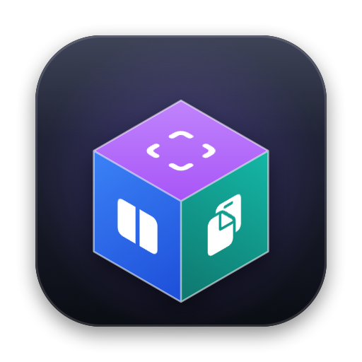

<p align="center"></p>

# PolyMac

> 여러 개의 Mac 도구를 하나의 가벼운 메뉴바 앱으로.
> Spectacle · TRex · Snipaste · AppCleaner · Maccy · Hazel · "터미널에서 열기"를 **가볍게 하나로** 묶는 macOS 오픈소스 유틸리티.

> **주의: 현재 버전 0.1.0-alpha.1 — 개인 사용용 초기 빌드입니다.** 직접 빌드해서 쓸 수 있습니다 → [지금 바로 쓰기](#지금-바로-쓰기-010-alpha1)
> 아래 "사용 방법"에는 아직 구현되지 않은 **예정 기능**도 섞여 있습니다. 지금 되는 것은 [현재 개발 상태](#현재-개발-상태) 표를 보세요.

---

## 목차

1. [왜 만드나](#왜-만드나)
2. [기능 한눈에 보기](#기능-한눈에-보기)
3. [지금 바로 쓰기 (0.1.0-alpha.1)](#지금-바로-쓰기-010-alpha1)
4. [현재 개발 상태](#현재-개발-상태)
5. [설치](#설치)
6. [처음 설정하기 (권한)](#처음-설정하기-권한)
7. [사용 방법](#사용-방법)
8. [문제 해결](#문제-해결)
9. [개인정보 · 보안](#개인정보--보안)
10. [버전 · 릴리즈](#버전--릴리즈)
11. [라이선스](#라이선스)
12. [문서](#문서)

---

## 왜 만드나

| 지금 쓰는 것 | 불편함 |
|---|---|
| Spectacle (창 분할) | 2022년에 저장소가 아카이브됨, 최신 macOS 대응 불확실 |
| TRex (OCR) | 캡처 도구와 따로 놀아서 "캡처 → 핀 → 텍스트 추출"이 끊김 |
| Snipaste (캡처·핀) | 클로즈드 소스, macOS 버전은 기능이 늦게 들어옴, OCR 없음 |
| AppCleaner (삭제) | 무엇이 어디에 왜 남았는지 안 보임. 그런데도 상주 비용은 듦 |
| Finder 확장들 | 잘라내기·터미널 열기·경로 복사가 각각 다른 앱 |
| Maccy (클립보드) | 캡처·OCR·경로 복사 결과와 따로 놀아 출처를 알 수 없음 |
| Hazel (폴더 정리) | 유료, 다른 도구와 감시를 따로 함 |
| (없음) 자소분리 | Mac에서 보낸 한글 파일명이 Windows·웹에서 `ㅎㅏㄴㄱㅡㄹ`로 깨짐 |

앱 여러 개 = 메뉴바 아이콘 여러 개, 권한 요청 여러 번, 단축키 충돌 관리 여러 군데, 상주 메모리 몇 배.

## 기능 한눈에 보기

| 모듈 | 기능 | 상주 방식 |
|---|---|---|
| **Window** | 단축키 창 분할(½, ⅓, ¼, 최대화, 다음 디스플레이), 엣지 드래그 스냅 | 상주 (경량) |
| **Capture** | 영역/창/전체 캡처, **화면에 고정(Pin)**, 비파괴 마크업(다시 편집 가능) | 상주 (단축키 대기만) |
| **OCR** | 캡처 즉시 텍스트 → 클립보드, 한/영 혼합, QR·URL·표 인식 | 필요 시 로드 |
| **Clipboard** | 클립보드 히스토리: 검색, 고정, 텍스트·이미지·파일, 비밀번호 앱 자동 제외 | 상주 (경량) |
| **Finder** | 진짜 `⌘X` 잘라내기, 여기서 터미널 열기, 경로 복사, 지정 폴더로 보내기 | 상주 (이벤트 감지만) |
| **Normalize** | 한글 **자소분리(NFD) 파일명 자동 복구**, 복사한 텍스트 NFC 변환, Windows 호환 압축 | 상주 (FSEvents 감시만) |
| **Organize** | 다운로드 폴더 자동 정리: 조건 + 동작 규칙을 직접 조합, 규칙별 on/off | 상주 (기본 꺼짐) |
| **Uninstaller** | 앱 잔여물을 **위치·종류·확신도별로** 보여주고 휴지통으로 제거, **이미 지운 앱의 흔적** 찾기 | **창을 열 때만** 동작, 닫으면 해제 |

모든 모듈은 설정에서 개별로 켜고 끌 수 있고, 꺼진 모듈은 메모리에 올라가지 않습니다.

**목표 수치**: 유휴 메모리 < 40 MB · 유휴 CPU 0% · 캡처 → OCR → 클립보드 < 500 ms

## 지금 바로 쓰기 (0.1.0-alpha.1)

Xcode 없이 **Command Line Tools만으로** 빌드됩니다.

**1. 빌드 · 설치**

```bash
git clone https://github.com/beomzh/PolyMac.git && cd PolyMac
```

```bash
scripts/build-app.sh --install
```

`/Applications/PolyMac.app`에 설치되고 실행됩니다. 메뉴바에 PolyMac 아이콘 아이콘이 생깁니다.

**2. 권한 주기** — 메뉴바 PolyMac 아이콘 › **환경 설정…**(`⌘,`) › 권한에서 경고 표시가 붙은 항목의 "허용하기…"를 누르면 해당 설정 화면이 열립니다. 켜 둔 기능에 필요한 권한이 빠지면 메뉴 맨 아래에 "권한이 필요합니다…"가 나타납니다.
- 손쉬운 사용: 창 분할, Finder `⌘X`, 클립보드 자동 붙여넣기
- 화면 녹음: 캡처, OCR (허용 후 PolyMac을 한 번 종료했다 다시 실행)
- 권한을 준 뒤 메뉴에서 해당 기능을 껐다 켜면 바로 적용됩니다 (특히 Finder 도구).

**3. (권장) 고정 인증서 만들기** — 인증서가 없으면 ad-hoc 서명이라 **다시 빌드할 때마다 macOS가 권한을 초기화**합니다. 아래 둘 중 하나만 해두면 빌드 스크립트가 자동으로 찾아 쓰고, 그다음부터는 권한이 유지됩니다.

- **Xcode가 있다면 (더 간단)**: Xcode › Settings › Accounts › `+`로 Apple ID 추가 (무료) → 계정 선택 › Manage Certificates… › `+` › **Apple Development**
- **Xcode 없이**: "키체인 접근" 앱 › 메뉴 **키체인 접근 › 인증서 지원 › 인증서 생성…** → 이름 `PolyMac Local`, 신원 유형 **자체 서명 루트**, 인증서 유형 **코드 서명**

그다음 `scripts/build-app.sh --install` → 아래 [권한 초기화](#문제-해결) 후 한 번만 다시 허용합니다. (처음 서명할 때 키체인 접근 허용 창이 뜨면 "항상 허용")

### 지금 동작하는 단축키

| 단축키 | 동작 |
|---|---|
| `⌥⌘←` / `⌥⌘→` | 왼쪽 / 오른쪽 절반 — 반복해서 누르면 ⅓ → ⅔ |
| `⌥⌘↑` / `⌥⌘↓` | 위 / 아래 절반 |
| `⌥⌘F` / `⌥⌘C` | 최대화 / 가운데 |
| `⌃⌥⌘→` / `⌃⌥⌘←` | 다음 / 이전 디스플레이 |
| `⌥⌘Z` | 창 위치 되돌리기 |
| `⌃⇧1` | 영역 캡처 → **편집 도구 막대** (사각형·화살표·펜·글자·모자이크·번호, 텍스트 추출, 핀, 저장, 복사) |
| `⌃⇧2` | 영역 선택 → **텍스트 추출** → 클립보드 (한/영, QR) |
| `⌃⇧3` | 영역 캡처 → 바로 **화면에 고정(핀)** |
| `⌃⇧4` | 클립보드 이미지 → 화면에 고정 |
| `⌃⇧5` | 클립보드 이미지 → **텍스트 추출** (다른 캡처 앱으로 찍은 것도) |
| `⇧⌘V` | 클립보드 히스토리 창 (검색 · 전체 내용 미리보기 · 출처 앱) |
| `⌘X` → `⌘V` | Finder에서 파일 잘라내기 → 붙여넣기(이동) — Finder 안에서만 |
| `⌃⌥T` | Finder 현재 폴더에서 터미널 열기 (터미널 앱 선택 가능) |
| `⌃⌥C` | Finder 선택 항목 경로 복사 (한글 NFC) |

**캡처 편집 도구 막대** (`⌃⇧1`로 영역을 고르면 아래에 나타남)

| 도구 | 키 |
|---|---|
| 사각형 / 화살표 / 펜 | `R` / `A` / `P` (다시 누르면 해제) |
| 글자 / 모자이크 / 번호 | `E` / `M` / `N` — 글자는 누른 곳에 입력하고 `↩`로 확정(`Esc` 취소), 모자이크는 가릴 곳을 드래그, 번호는 누를 때마다 1, 2, 3… |
| 색상 | 도구 막대의 동그라미 8개 또는 `1`~`8` — 빨강(기본)·주황·노랑·초록·파랑·보라·검정·흰색 |
| 되돌리기 | `⌘Z` |
| 텍스트 추출 / 화면에 고정 / 저장 | `T` / `F` / `⌘S` |
| 복사하고 끝내기 / 취소 | `↩︎` 또는 `⌘C` / `Esc` |

**캡처 화면** — 화면이 어두워지고 커서에 십자선이 생기며, 왼쪽 아래에 그 단계에서 쓸 수 있는 키가 표시됩니다.
- **돋보기**: 커서 옆에 15×15 픽셀 확대, 좌표, 그 위치 색상(RGB/HEX). `C` 색상 복사, `⇧` RGB↔HEX
- **크기 표시**: 선택 영역 왼쪽 위에 픽셀 크기
- **영역 조정** (영역을 고른 뒤): 안쪽 드래그로 이동, **테두리 어디든** 드래그해 크기 조절(모서리는 두 방향), 방향키 1px 이동(`⇧` 10px), `⌘A` 화면 전체

**창 자동 감지** — 영역 선택 화면에서 마우스를 올린 창의 테두리가 파랗게 표시됩니다. **클릭만 하면 그 창 크기 그대로** 선택되고, 드래그하면 원하는 영역을 직접 고릅니다. 캡처가 끝나면 쓰던 앱으로 포커스가 돌아갑니다.

도구를 고르지 않은 상태에서 영역 밖을 드래그하면 영역을 다시 고릅니다 (표시를 그린 뒤에는 영역이 유지됩니다). 텍스트 추출은 그린 표시를 빼고 원본에서 읽습니다.

**핀** — 드래그로 이동 · 스크롤로 확대/축소 · `⌥`+스크롤로 투명도
닫기: 핀 위에 마우스를 올리고 `Esc` · 핀을 클릭한 뒤 `Esc`/`⌫` · 더블클릭 · 우클릭 › 닫기 (`⌫`는 다른 앱 글자를 지우지 않도록 핀을 클릭했을 때만 받습니다). 클릭한 핀에서 `⌘C`는 복사
우클릭 › **표시 편집**으로 고정한 뒤에도 사각형·화살표·펜·글자·모자이크·번호를 더하거나 되돌릴 수 있습니다 (표시는 이미지에 굽지 않고 따로 보관). 복사·저장은 표시를 합친 이미지, 텍스트 추출은 원본으로 합니다.

**클립보드 히스토리 창** (`⇧⌘V`)
- 평소에는 **간략한 목록**만: 앱 아이콘 + 한 줄 요약(줄바꿈은 ⏎) 또는 **이미지 썸네일**, 오른쪽에 `⌘1`~`⌘0` (위에서 10개)
- 오른쪽 위 버튼 또는 `⌘→`로 **미리보기 패널이 옆으로 펼쳐짐** (`⌘←`로 접기, 마지막 상태 기억): 전체 텍스트(일부 선택 가능) 또는 큰 이미지, 아래에 복사한 앱·시각·글자 수/해상도
- 검색: 내용·앱 이름, 띄어쓰기로 여러 단어, "이미지"로 이미지만
- `↑↓` 이동 · `↩︎`·더블클릭·`⌘1~9`·`⌘0` **클립보드로 복사** · `⇧↩︎` 복사 후 앞의 앱에 바로 붙여넣기 · `⌘P` 고정/해제 · `⌘⌫` 삭제 · `Esc` 닫기 · 다른 곳 클릭하면 닫힘
- **이미지도 기록**합니다 (캡처, 복사한 사진 등 — 한 장 30 MB까지). 같은 이미지는 한 번만 저장
- **보관 기간**: 메뉴바 PolyMac 아이콘 › 클립보드 히스토리 › 보관 기간 (1 / 3 / **7** / 30일 / 제한 없음). 기간이 지난 항목은 1시간마다 확인해 지움
- **보관 개수**: 같은 메뉴 › 보관 개수 (50 / 100 / **200** / 500 / 1000개). 기간 안이라도 개수를 넘으면 오래된 것부터 지움
- 고정한 항목은 기간·개수 모두에서 빠지며, 지운 항목의 이미지·텍스트 파일도 함께 삭제
- **긴 텍스트(로그 등)도 전체 보관**: 64 KB가 넘으면 전체를 별도 파일로 저장하고 목록에는 앞부분만 둡니다. 복사하면 전체가 들어가고, 미리보기는 앞 200 KB까지 보여 줍니다. 한 항목 최대 20 MB
- 앞에 쓰던 앱의 포커스를 빼앗지 않아서 `⇧↩︎`로 고르면 그 앱에 바로 붙여넣어집니다

**Finder 잘라내기에 대해** — macOS Finder에는 파일 잘라내기가 없습니다. 파일을 고르고 `⌘X`를 눌러도 아무 일이 없고(편집 › 잘라내기 비활성), 이름을 편집할 때만 글자 잘라내기로 동작합니다. macOS 기본 이동 방법은 `⌘C` → 옮길 폴더에서 `⌥⌘V`입니다. PolyMac은 Finder 안에서만 `⌘X`를 `⌘C`로, 그 뒤의 `⌘V`를 `⌥⌘V`로 바꿔 보냅니다. 두 키 모두 단축키 설정에서 바꾸거나 끌 수 있습니다.

쓰는 순서:
1. Finder에서 파일·폴더를 클릭해 **선택만** 한다 (이름이 편집 상태면 안 됨 — 그때는 글자 잘라내기로 동작)
2. `⌘X` → 화면 아래 "잘라내기 — 옮길 폴더에서 ⌘V" 안내가 뜨면 성공
3. 옮길 폴더를 Finder 창으로 연다 (다른 앱을 잠깐 다녀와도 됨)
4. 그 Finder 창을 클릭해 앞으로 가져온 뒤 `⌘V` → 파일이 **이동**됨 (`⌘Z`로 되돌리기 가능)

`⌘X` 뒤에 다른 것을 복사하면 잘라내기는 취소되고 `⌘V`는 평소 붙여넣기가 됩니다. 2번에서 안내가 뜨지 않으면 환경 설정 › 권한에서 손쉬운 사용을 확인하고, `log stream --predicate 'subsystem == "dev.polymac" AND category == "finder"'`로 어느 단계에서 통과됐는지 볼 수 있습니다 (키 내용은 기록하지 않음).

**터미널 앱 고르기** — 메뉴바 PolyMac 아이콘 › Finder 도구 › 터미널 앱. 설치된 것만 표시됩니다 (터미널, iTerm2, Ghostty, Warp, WezTerm, Alacritty, kitty).

**PolyMac 창 닫기** — 단축키 설정·앱 삭제 창은 `Esc` 또는 `⌘W`로 닫힙니다. `⌘Q`는 PolyMac 창이 떠 있으면 그 창만 닫고, 창이 없을 때만 PolyMac을 종료합니다 (캡처 중에는 아무 일도 하지 않음).

**환경 설정** — 메뉴바 PolyMac 아이콘 › **환경 설정…**(`⌘,`). 탭은 네 개입니다.

| 탭 | 내용 |
|---|---|
| 기능 | 기능별 켜기/끄기(끄면 메모리에서 내려가고 단축키 해제), 로그인 시 자동 실행, 데이터 폴더 |
| 언어 | 시스템 설정 따르기 / 한국어 / English — 바로 바뀜 |
| 단축키 | 모든 단축키 보기·바꾸기·기본값으로 |
| 권한 | 권한별 허용 상태, 그 권한을 쓰는 기능, 시스템 설정 바로가기 |

**단축키 바꾸기** — 메뉴바 PolyMac 아이콘 › **환경 설정…**(`⌘,`) › 단축키. 바꿀 항목을 클릭하고 새 조합을 누르면 바로 적용됩니다.
- `Esc` 취소 · `⌫` 사용 안 함 · ↩︎ 버튼으로 기본값 복원 · "모두 기본값으로"
- PolyMac 안에서 이미 쓰는 조합은 거부하고, 다른 앱이 쓰는 조합이면 경고 표시로 알려줍니다.
- `⌘`·`⌃`·`⌥` 중 하나 이상이 들어가야 합니다 (F키는 단독 가능). 바꾼 값은 앱을 다시 빌드·설치해도 유지됩니다.
- Finder 잘라내기·붙여넣기도 목록에 있습니다 ("Finder 안에서만"). 바꾸면 Finder 안에서 그 조합을 씁니다.

### 자소분리 자동 정리

켜져 있으면 **다운로드·데스크탑 폴더 바로 아래** 항목의 NFD 이름을 NFC로 바꿉니다(겉보기 이름은 같고, 다른 OS에서 안 깨지게 됩니다). iCloud 동기화 폴더는 건드리지 않습니다. 폴더 추가:

```bash
defaults write dev.polymac.app normalize.extraFolders -array "~/Documents/받은파일"
```

### 다운로드 폴더 자동 정리

기본으로 **꺼져 있습니다.** 메뉴에서 켜면 처음엔 **미리보기 모드**라 실제로 옮기지 않고 기록만 남깁니다.

1. 메뉴바 PolyMac 아이콘 › 환경 설정 › 기능 › 다운로드 폴더 자동 정리
2. PolyMac 아이콘 › 다운로드 폴더 자동 정리 › **규칙 파일 편집…** → 원하는 규칙의 `"isEnabled"`를 `true`로 (프리셋 5개는 모두 꺼진 상태)
3. **규칙 다시 불러오기** → **정리 기록 보기**에서 미리보기 결과 확인
4. 괜찮으면 **미리보기 모드** 체크 해제 → 실제로 동작. 잘못됐으면 **마지막 정리 되돌리기**

규칙 하나의 모양 (`~/Library/Application Support/PolyMac/organize.json`의 `rules` 배열에 추가):

```json
{
  "actions" : [
    { "move" : { "to" : "~/Documents/{domain}/{yyyy}-{MM}" } },
    { "rename" : { "template" : "{yyyy}{MM}{dd}_{name}" } }
  ],
  "conditions" : [
    { "sourceDomain" : { "domains" : [ "*.go.kr" ] } },
    { "nameMatches" : { "isRegex" : false, "pattern" : "*신청서*" } }
  ],
  "id" : "6F1C2A4E-0000-4000-8000-000000000001",
  "isEnabled" : true,
  "match" : "all",
  "name" : "정부 사이트 신청서는 날짜 붙여 문서 폴더로",
  "stopAfterMatch" : true
}
```

| 조건 키 | 값 |
|---|---|
| `fileExtension` | `{ "extensions": ["pdf", "hwp"] }` |
| `kind` | `{ "kinds": ["image"] }` — image, video, audio, document, archive, installer, code, other |
| `nameMatches` | `{ "pattern": "*견적서*", "isRegex": false }` |
| `sourceDomain` | `{ "domains": ["github.com", "*.go.kr"] }` |
| `sizeGreaterThan` / `sizeLessThan` | `{ "bytes": 104857600 }` |
| `addedMoreThan` / `notOpenedFor` | `{ "days": 7 }` |
| `isDuplicate` | `{}` (아직 판정하지 않음 — 다음 버전) |
| `not` | `{ "condition": { ...위 조건 하나... } }` |

| 동작 키 | 값 |
|---|---|
| `move` / `copy` | `{ "to": "~/폴더/{yyyy}-{MM}" }` — 홈 폴더 밖은 거부 |
| `rename` | `{ "template": "{yyyy}{MM}{dd}_{name}" }` — 확장자는 자동 유지 |
| `trash` | `{}` — 휴지통으로 (영구 삭제 없음) |
| `addTag` | `{ "name": "업무" }` |
| `notify` | `{}` — 손대지 않고 알림만 |

`"id"`는 규칙마다 달라야 합니다 (터미널에서 `uuidgen`으로 만들 수 있습니다).

### 데이터 위치

모두 `~/Library/Application Support/PolyMac/` (폴더 0700, 파일 0600) — 환경 설정 › 기능 › 데이터 폴더 "Finder에서 열기"

| 파일 | 내용 |
|---|---|
| `clipboard.json` | 클립보드 히스토리 목록 (보관 개수 설정 + 고정 항목) |
| `clipboard-images/` | 클립보드에 복사된 이미지 (PNG, 기록에서 지우면 같이 삭제) |
| `clipboard-texts/` | 64 KB가 넘는 긴 텍스트의 전체 내용 (기록에서 지우면 같이 삭제) |
| `organize.json` | 자동 정리 규칙 |
| `organize-log.txt` | 자동 정리 기록 (미리보기 포함) |

### 아직 안 되는 것 (다음 버전)

엣지 드래그 스냅 · 클립보드 저장 암호화 · 자동 정리 설정 화면

## 현재 개발 상태

| 모듈 | 상태 | 지금 되는 것 | 아직 안 되는 것 |
|---|---|---|---|
| Core | 동작 | 모듈 on/off, 전역 단축키 + **변경 화면**, 권한 안내, 안내 토스트, 로그인 시 실행, 환경설정(기능·언어·단축키·권한) | — |
| Window | 동작 | 절반·⅓·⅔·최대화·가운데·디스플레이 이동·되돌리기 | 엣지 드래그 스냅 |
| Capture | 동작 | 영역 캡처, 창 자동 감지, 돋보기·색상 복사, 영역 이동·크기 조절, 편집 도구 막대(사각형·화살표·펜·글자·모자이크·번호), 핀 + 표시 다시 편집, 저장 | 최근 캡처 기록 |
| OCR | 동작 | 한/영 인식, QR, NFC 복사, 클립보드 이미지 인식, 줄바꿈 정리(그대로·문단·한 줄) | 표 인식, 단어장 |
| Clipboard | 동작 | 텍스트(긴 로그 포함)·이미지·파일 히스토리, 간략 목록 + 펼치는 미리보기, 검색, 출처 앱, 고정, 보관 기간(기본 7일)·개수, 비밀번호 제외, 앱별 제외 | 저장 암호화 |
| Finder | 동작 | 잘라내기(단축키 변경 가능), 터미널 열기(앱 선택), 경로 복사, 우클릭 메뉴(서비스), 지정 폴더로 보내기 | 에디터로 열기 |
| Normalize | 동작 | 다운로드·데스크탑 자동 NFC 변환, 우클릭 정리(하위 폴더까지), Windows용 압축 | 클립보드 텍스트 NFC |
| Organize | 일부 | 규칙 엔진, 감시·실행·미리보기·되돌리기 (JSON 편집) | 설정 화면, 중복 판정 |
| Uninstaller | 동작 | 설치된 앱 잔여물 찾기(확실·유력·추정), 이미 지운 앱의 흔적, Finder 휴지통으로 이동, 실행 중 앱 종료·백그라운드 항목 내리기, 설치 기록 `pkgutil --forget`, 삭제 전 목록 저장 | — |

설계: 설계만 · 일부: 일부 동작 · 동작: 주요 기능 동작 — 세부 계획은 [ROADMAP](docs/ROADMAP.md)

## 설치

### 앱 설치 (0.1.0부터 예정)

[GitHub Releases](https://github.com/beomzh/PolyMac/releases)에서 `PolyMac-X.Y.Z.zip`을 받아 압축을 풀고 `PolyMac.app`을 `/Applications`로 옮깁니다. 받은 파일이 변조되지 않았는지 확인하려면:

```bash
shasum -a 256 -c PolyMac-X.Y.Z.zip.sha256
```

1.0.0 이후에는 Homebrew로도 설치할 수 있게 할 예정입니다.

### 소스에서 빌드 (지금 가능)

앱 설치는 [지금 바로 쓰기](#지금-바로-쓰기-010-alpha1)의 `scripts/build-app.sh --install`을 쓰세요. 아래는 개발용입니다.

필요한 것: macOS 14 이상, Command Line Tools (`xcode-select --install`). `swift test` 실행과 Finder 확장 빌드에는 Xcode 16 이상이 필요합니다.

```bash
git clone https://github.com/beomzh/PolyMac.git
```

```bash
cd PolyMac && swift build
```

```bash
scripts/test.sh
```

`scripts/test.sh`는 설치된 Xcode를 찾아 `swift test`를 실행합니다 (`xcode-select`를 바꿀 필요 없음).

## 처음 설정하기 (권한)

macOS는 이런 종류의 앱에 권한을 따로 요구합니다. PolyMac은 **모듈을 처음 켤 때 그 모듈에 필요한 권한만** 요청합니다.

| 권한 | 시스템 설정 위치 | 필요한 모듈 |
|---|---|---|
| 손쉬운 사용 | 개인정보 보호 및 보안 › 손쉬운 사용 | Window, Finder(`⌘X`) |
| 화면 및 시스템 오디오 녹음 | 개인정보 보호 및 보안 › 화면 및 시스템 오디오 녹음 | Capture, OCR |
| 자동화 › Finder | 개인정보 보호 및 보안 › 자동화 | Finder 단축키(터미널 열기·경로 복사 — 우클릭 메뉴는 필요 없음) |
| 파일 및 폴더 | 개인정보 보호 및 보안 › 파일 및 폴더 | Normalize, Organize |
| 전체 디스크 접근 | 개인정보 보호 및 보안 › 전체 디스크 접근 | (요구하지 않음 — 앱 삭제는 Finder에 맡김) |
| Finder 확장 | 일반 › 로그인 항목 및 확장 프로그램 › Finder | 터미널 열기·경로 복사 메뉴 |

- 권한을 주지 않아도 앱은 동작하고, 해당 기능만 꺼진 채 안내가 표시됩니다.
- macOS 15부터 화면 녹음 권한은 주기적으로 다시 확인을 요청합니다. 시스템 정책이라 앱에서 막을 수 없습니다.

## 사용 방법

> 아래 단축키는 **기본값(예정)** 이며 모두 설정에서 바꿀 수 있습니다. 다른 앱·시스템 단축키와 겹치면 설정 화면에서 경고합니다.

### 창 분할 — Window (0.1.0)

Spectacle 기본 단축키와 같게 맞춰서 옮겨와도 손에 익은 그대로 쓸 수 있습니다.

| 동작 | 단축키 |
|---|---|
| 왼쪽 / 오른쪽 절반 | `⌥⌘←` / `⌥⌘→` |
| 위 / 아래 절반 | `⌥⌘↑` / `⌥⌘↓` |
| 최대화 | `⌥⌘F` |
| 가운데 | `⌥⌘C` |
| 다음 / 이전 디스플레이 | `⌃⌥⌘→` / `⌃⌥⌘←` |
| 되돌리기 | `⌥⌘Z` |

- 같은 단축키를 반복하면 ½ → ⅓ → ⅔ 순으로 크기가 바뀝니다.
- `⌥⌘C`(가운데)는 Finder의 기본 "경로 복사" 단축키와 겹칩니다. Spectacle과 같게 두었지만, Finder에서 경로 복사를 자주 쓴다면 설정에서 바꾸세요.
- 창을 화면 가장자리로 끌면 해당 위치로 붙습니다(설정에서 끄기 가능).

### 캡처 · 핀 · 마크업 — Capture (0.2.0)

| 동작 | 단축키 |
|---|---|
| 영역 캡처 | `⌃⇧1` |
| 캡처 즉시 화면에 고정 | `⌃⇧3` |
| 클립보드 이미지를 화면에 고정 | `⌃⇧4` |

1. `⌃⇧1` → 화면이 어두워지고 마우스를 올린 **창의 경계가 자동으로 잡힙니다**. 클릭하면 그 창, 드래그하면 원하는 영역.
2. 영역 선택 중 돋보기에 **픽셀 좌표와 색상**이 표시됩니다. `C`를 누르면 색상 코드 복사.
3. 선택 후 아래 도구 막대에서 사각형·화살표·펜·텍스트·모자이크·번호 스탬프로 표시.
4. `Enter` 클립보드 복사 · `⌘S` 저장 · `P` 화면에 고정 · `T` 텍스트 추출 · `Esc` 취소

**핀(고정된 캡처)**
- 스크롤: 확대/축소 · `⌥` + 스크롤: 투명도 · 더블클릭: 닫기
- 우클릭 메뉴: 마크업 다시 편집, 클릭 통과 모드(핀 아래 창을 그대로 조작), 모든 데스크톱에 표시
- 마크업은 그림에 굽지 않고 따로 저장되므로 **나중에 다시 열어 고칠 수 있습니다.**

### 텍스트 추출 — OCR (0.3.0)

| 동작 | 단축키 |
|---|---|
| 영역 선택 → 텍스트를 바로 클립보드로 | `⌃⇧2` |

- 결과는 화면 구석에 잠깐 미리보기로 뜨고, 클릭하면 수정 후 다시 복사할 수 있습니다.
- 인식 결과가 **URL이면 열기 버튼, QR·바코드면 내용**을 바로 보여줍니다.
- 고정된 핀 위에서는 글자를 마우스로 드래그해 일부만 복사할 수 있습니다.
- 설정
  - 언어 우선순위 (기본: 한국어 → 영어)
  - 줄바꿈 (메뉴 › 텍스트 추출 › 줄바꿈): 보이는 줄 그대로(기본) / 문단으로 잇기(PDF·웹 글처럼 중간에 끊긴 줄을 잇고 문단 사이만 줄바꿈) / 한 줄로(검색창·번역기용). 영어 줄 끝 하이픈(`recog-` + `nition`)은 붙여 줍니다.
  - 코드 모드: 공백·들여쓰기 보존
  - 사용자 단어장: 자주 틀리는 고유명사 등록
  - 작은 글씨 보정: 2배 확대 후 인식
- macOS 26 이상에서는 **표를 인식해 엑셀에 붙여넣을 수 있는 형태(TSV)나 Markdown 표**로 복사합니다.
- 다른 자동화에서 부르기: 단축어(Shortcuts) 앱의 "PolyMac 텍스트 추출" 동작, 또는 `polymac://ocr`

### 클립보드 히스토리 — Clipboard (0.4.0)

| 동작 | 단축키 |
|---|---|
| 히스토리 열기 | `⇧⌘V` |
| 선택 항목 복사 / 바로 붙여넣기 | `↩` / `⇧↩` (붙여넣기는 손쉬운 사용 권한 필요) |
| 위에서 1~10번째 바로 고르기 | `⌘1` ~ `⌘0` |
| 고정 / 고정 해제 | `⌘P` |
| 삭제 | `⌘⌫` |
| 미리보기 펼치기 / 접기 | `⌘→` / `⌘←` |

- 목록을 연 상태에서 바로 타이핑하면 검색됩니다.
- 기록하는 것: 텍스트(20 MB까지, 긴 로그는 전체 보관), 이미지, **Finder에서 복사한 파일·폴더**(경로만 기록 — 고르면 다시 파일로 들어가 Finder에서 `⌘V`로 붙여넣기).
- 각 항목에 복사한 앱 아이콘이 붙습니다.
- **기록하지 않는 것**: 비밀번호 관리자가 "숨김"으로 표시한 복사, 키체인 접근·암호·1Password·Bitwarden, 직접 제외한 앱.
- **앱 제외**: 제외할 앱을 앞에 둔 채 메뉴바 › 클립보드 히스토리 › **기록하지 않을 앱** › "'앱 이름'에서 복사한 것은 기록 안 함". 같은 메뉴에서 눌러 다시 기록.
- 메뉴바 › 클립보드 히스토리 › "기록 일시정지"로 잠시 멈출 수 있고, 보관 개수·기간(기본 200개·7일)도 여기서 바꿉니다.

### Finder 도구 — Finder (0.5.0)

**잘라내기 / 붙여넣기**

| 동작 | 단축키 |
|---|---|
| 잘라내기 | `⌘X` (Finder에서 파일 선택 후) |
| 이동 붙여넣기 | `⌘V` (옮길 폴더의 Finder 창에서) |
| 지정 폴더로 보내기 | Finder 우클릭 › 빠른 동작(또는 서비스) › **PolyMac: 폴더로 보내기…** — 이동 또는 복사, 마지막 폴더 기억 |

- `⌘X` 후 화면 아래에 **"잘라내기 — 옮길 폴더에서 ⌘V"** 안내가 뜹니다. 취소하려면 다른 것을 복사하거나 그냥 `⌘C`를 누르면 됩니다.
- 실제 이동은 Finder가 하므로 **`⌘Z`로 되돌리기**, 이름 충돌 대화상자, 진행률 표시가 그대로 동작합니다.
- 파일 이름을 편집 중일 때의 `⌘X`는 평소처럼 글자 잘라내기로 동작합니다.
- 자세한 순서와 안 될 때 확인할 것은 위 "지금 바로 쓰기"의 Finder 잘라내기 부분을 보세요.

**터미널 열기 · 경로 복사** — 단축키 `⌃⌥T` / `⌃⌥C`, 또는 Finder 우클릭 › 빠른 동작(또는 서비스) › **PolyMac: 여기서 터미널 열기 / 경로 복사** (우클릭은 자동화 권한 없이 동작)
- 터미널 앱 선택: 터미널 / iTerm2 / Ghostty / Warp / WezTerm / Alacritty / kitty (설치된 것만)
- 경로 복사: 여러 개면 줄바꿈으로, 한글은 NFC로

> 참고: macOS 기본 기능으로도 Finder에서 `⌥⌘C`를 누르면 경로가 복사됩니다.

### 한글 자소분리 해결 — Normalize (0.5.0)

Mac에서 만든 한글 파일명이 Windows나 웹 업로드에서 `ㅎㅏㄴㄱㅡㄹ`처럼 깨지는 문제를 막습니다.

- **자동**: 감시 폴더(기본: 다운로드·데스크탑·스크린샷 폴더)에 들어온 파일 이름을 자동으로 고칩니다. 설정에서 폴더 추가·제외.
- **수동**: Finder 우클릭 › **PolyMac: 한글 파일명 정리** → 바뀔 개수를 먼저 보여주고 확인 후 하위 폴더까지 변환 (앱·번들 안, 숨김 파일, .git은 그대로).
- **압축**: Finder 우클릭 › **PolyMac: Windows용으로 압축** → 이름을 NFC로 바꾸고 zip에 "UTF-8 이름" 표시를 켜서 Windows에서도 한글이 정상인 zip을 옆에 만듭니다. `.DS_Store`·`__MACOSX`는 넣지 않습니다 (4 GB까지). macOS 기본 압축은 이 표시를 남기지 않아 Windows에서 이름이 깨집니다.
- 복사한 텍스트·경로도 자동으로 고쳐서 클립보드에 넣습니다.
- 다음 위치는 기본적으로 **건드리지 않습니다**: git 저장소, iCloud Drive·Dropbox 폴더, 앱 번들 내부, `~/Library`, 오래된 형식(HFS+)의 외장 디스크.

### 다운로드 폴더 자동 정리 — Organize (0.6.0)

정리 방식은 사람마다 다르므로, **규칙을 직접 조합**합니다. 기능 전체 / 감시 폴더별 / 규칙별로 각각 켜고 끌 수 있습니다.

**규칙 = 조건 + 동작**

| 조건 | 예 |
|---|---|
| 확장자 | `pdf`, `hwp` |
| 파일 종류 | 이미지 · 동영상 · 오디오 · 문서 · 압축 · 설치 파일 · 코드 |
| 이름 패턴 | `*견적서*` 또는 정규식 |
| 받은 사이트 | `github.com`, `*.go.kr` |
| 크기 | 100 MB 초과 / 1 MB 미만 |
| 받은 지 N일 | 7일 지남 |
| N일간 안 열어봄 | 30일 |
| 중복 | 같은 내용의 파일이 이미 있음 |
| ~이 아님 | 위 조건을 뒤집기 |

조건은 "모두 만족" 또는 "하나라도 만족"으로 묶고, 위에서부터 순서대로 검사합니다.

| 동작 | 예 |
|---|---|
| 이동 / 복사 | `~/Documents/받은문서/{yyyy}-{MM}` |
| 이름 바꾸기 | `{yyyy}{MM}{dd}_{name}` |
| 휴지통으로 | (영구 삭제는 지원하지 않음) |
| Finder 태그 | `업무` |
| 알림만 | 손대지 않고 "정리 후보"로 표시 |

경로·이름에 쓸 수 있는 값: `{name}` 파일 이름 · `{ext}` 확장자 · `{kind}` 종류 · `{domain}` 받은 사이트 · `{yyyy}` `{MM}` `{dd}` 날짜

**예시 규칙** — "정부 사이트에서 받은 신청서는 날짜를 붙여 문서 폴더로"
- 조건(모두 만족): 받은 사이트 `*.go.kr` + 이름 패턴 `*신청서*`
- 동작: 이동 `~/Documents/{domain}/{yyyy}-{MM}` + 이름 바꾸기 `{yyyy}{MM}{dd}_{name}`
- 결과: `지원금 신청서.hwp` → `~/Documents/gov.go.kr/2026-10/20261027_지원금 신청서.hwp`

**기본 제공 프리셋** (모두 꺼진 상태, 골라서 켜기): 설치 파일 7일 후 휴지통 · 문서는 월별 폴더로 · 이미지는 사진 폴더로 · 받은 사이트별 폴더로 · 30일 안 연 파일 알림

**안전장치**
- 처음 켜면 **미리보기 모드**: 실제로 옮기지 않고 "이렇게 정리될 예정" 목록만 보여줍니다. 확인 후 끄면 실제로 동작합니다.
- 다운로드 중인 파일은 건드리지 않고, 다운로드가 끝난 뒤 10초(변경 가능) 기다렸다 처리합니다.
- 같은 이름이 있으면 덮어쓰지 않고 `이름 (2)`로 저장합니다.
- 처리 기록에서 언제든 **되돌리기** 할 수 있습니다.
- 규칙은 파일로 내보내고 가져올 수 있습니다(가져온 규칙은 미리보기 모드로 시작).

### 앱 완전 삭제 — Uninstaller

메뉴바 PolyMac 아이콘 › 맨 위 **앱 완전 삭제…** (이미 지운 앱의 흔적은 창 왼쪽 위 **남은 흔적** 탭, 또는 메뉴 › 앱 완전 삭제 › 이미 지운 앱의 흔적 찾기…). 창을 닫으면 메모리에서 내려갑니다.

**설치된 앱 지우기**
1. 왼쪽 목록에서 고르거나(검색 가능, `/Applications` 아래 폴더까지) 앱을 창에 끌어다 놓기
2. 남는 파일이 **종류별로** 묶여 용량과 함께 표시됩니다 — 앱 본체 · 앱 데이터 · 캐시 · 설정 · 샌드박스 데이터 · 공유 데이터 · 창 상태 · 웹 데이터 · 로그 · 백그라운드 항목 · 관리자 도우미 · 설치 기록. 종류마다 **지워도 되는지 설명**이 붙어 있습니다
3. 항목마다 **판단 근거**와 등급
   - **확실** — 앱 ID(`com.회사.앱`)와 일치, 또는 개발사 팀 ID + 앱 ID (기본 선택)
   - **유력** — 같은 개발사 데이터, 앱 안의 프로그램을 실행하는 백그라운드 항목, 앱 이름과 같은 폴더, 설치 기록 (기본 선택)
   - **추정** — 이름에 앱 이름이 들어 있을 뿐 (기본 선택 안 함, 돋보기 버튼으로 Finder에서 확인 후 직접 선택)
4. **휴지통으로 이동** (`⌘⌫`) — 앱이 실행 중이면 먼저 종료하고, 로그인 시 실행되는 백그라운드 항목은 내린 뒤, **Finder에게 휴지통으로 옮기게** 합니다
   - Finder 휴지통의 **되돌려 놓기**로 복구할 수 있습니다
   - `/Library` 아래 항목은 Finder가 관리자 암호를 묻습니다
   - **설치 기록**(pkg)은 휴지통으로 옮기지 않고 `pkgutil --forget`으로 지웁니다 (macOS 암호 창이 한 번 뜸). 파일만 옮기면 pkgutil 목록에 흔적이 남기 때문입니다
   - macOS 기본 앱과 PolyMac 자신은 지울 수 없습니다
5. (선택) **목록 저장…** — 지우기 전에 고른 항목(없으면 전체)의 경로·크기·수정일·이유를 표 파일(.tsv)로 남깁니다

**이미 지운 앱의 흔적** — 앱은 지웠는데 설정·캐시·데이터가 남은 것을 찾습니다.
- 앱 ID 형태의 이름 중 **이 Mac에 그 앱이 없는 것**만 (macOS 기본 `com.apple.*` 제외)
- 설치된 앱의 하위 항목(예: `com.회사.앱.ShipIt` 업데이터)은 제외
- 백그라운드 항목은 **실행할 프로그램이 아직 있으면 제외** (앱 없이 설치되는 보안 프로그램 등을 깨뜨리지 않게), 프로그램이 지워졌으면 "유력"
- 지금 등록된 서비스가 쓰는 파일(관리자 도우미 등)은 제외
- 같은 회사의 다른 앱이 설치돼 있으면 공용 구성요소일 수 있어 "추정"으로 낮춤

**지우기 전에 보이는 것**
- 항목마다 **마지막 수정일**(안쪽 파일까지 포함), 앱은 **마지막 사용일**(Spotlight 기록)
- **사용 중**인 항목 — 실행 파일이 그 안에 있거나 파일을 열어 둔 프로그램이 있으면 "사용 중 (프로그램 이름)"으로 표시하고 선택할 수 없습니다. 그 프로그램을 끄고 다시 찾으면 됩니다
- 앱이 자기 폴더(`/Applications/회사/앱.app`) 안에 있고 그 폴더에 다른 앱이 없으면 **폴더째** 후보에 들어갑니다 (설치 관리자·리소스까지). 여러 앱을 모아 둔 폴더는 건드리지 않습니다
- 다른 앱의 샌드박스 데이터(`~/Library/Containers/…`)는 macOS가 보호해서, 지울 때 "다른 앱의 데이터에 접근" 허용 창이 뜰 수 있습니다

어떤 기준으로 판단하는지(찾는 위치 전체, 등급 조건, 회사 이름 필터, 제외 조건)는 [docs/UNINSTALLER.md](docs/UNINSTALLER.md)에 있습니다.

삭제 기록: `~/Library/Application Support/PolyMac/uninstall-log.txt`

## 문제 해결

**PolyMac을 다른 폴더(예: `/Applications/다운로드 폴더/`)로 옮기면**
- 권한(손쉬운 사용·화면 녹음)은 위치가 아니라 서명으로 묶여 있어 그대로 유지됩니다.
- 기능·데이터(`~/Library/Application Support/PolyMac`)는 영향이 없습니다.
- **로그인 시 자동 실행**은 옮기기 전 위치를 기억할 수 있으니 환경 설정 › 기능에서 껐다 켜 주세요.
- `scripts/build-app.sh --install`은 항상 `/Applications/PolyMac.app`에 설치합니다. 옮긴 복사본이 따로 남아 두 개가 되면, 둘이 동시에 실행돼 단축키가 겹칠 수 있으니 하나는 지우세요.


| 증상 | 해결 |
|---|---|
| 단축키가 안 먹히거나 다른 앱이 반응함 | 같은 단축키를 쓰는 앱(Spectacle 등)을 종료. macOS는 다른 앱과의 충돌을 항상 알려주지는 않으므로 환경 설정 › 단축키에 경고 표시가 없어도 겹칠 수 있음. 창 분할은 손쉬운 사용 권한 필요 |
| 권한을 줬는데도 계속 요청함 | 시스템 설정에서 PolyMac 항목을 `-`로 지우고 앱 재시작 후 다시 허용. 직접 빌드했다면 매번 같은 인증서로 서명했는지 확인 ([RELEASING](docs/RELEASING.md) 6) |
| 캡처 중 화면이 어둡게 멈춘 것 같음 | `Esc`(다른 앱에 포커스가 있어도 동작) 또는 우클릭으로 취소. 모니터 연결·해제·덮개 닫기 등 화면 구성이 바뀌면 자동 취소, 60초가 지나도 자동 취소 |
| 캡처가 검은 화면이거나 바탕화면만 찍힘 | 화면 녹음 권한 허용 후 PolyMac 종료 → 다시 실행 |
| 설정에선 허용돼 있는데 동작 안 함 / 다시 빌드했더니 권한이 풀림 | ad-hoc 서명은 빌드마다 다른 앱으로 취급돼, 설정의 허용 표시가 **예전 빌드**를 가리킵니다. 아래 "권한 초기화" 후 다시 허용하세요. 반복을 막으려면 [고정 인증서](#지금-바로-쓰기-010-alpha1)를 만드세요 |
| Finder `⌘X`가 그냥 복사만 됨 | 손쉬운 사용 권한이 없는 상태입니다. 허용하면 2초 안에 자동으로 켜지고 "⌘X 잘라내기가 켜졌습니다" 안내가 뜹니다. PolyMac 아이콘 › Finder 도구에서 상태 확인 |
| Finder 우클릭 메뉴에 PolyMac이 없음 | 항목을 고른 뒤 우클릭 › 빠른 동작 또는 서비스 아래를 확인. 그래도 없으면 시스템 설정 › 키보드 › 키보드 단축키 › 서비스 › 파일 및 폴더에서 PolyMac 항목을 켜고, PolyMac을 /Applications에서 한 번 다시 실행 |
| 자동 정리가 동작하지 않음 | 모듈·감시 폴더·규칙이 모두 켜져 있는지, 미리보기 모드가 켜져 있는지 확인 |

**인증서를 만들었는데 빌드가 "인증서가 없어 ad-hoc 서명"이라고 함** — 인증서를 검증할 Apple 중간 인증서(WWDR G3)가 키체인에 없는 경우입니다. 확인:

```bash
security find-identity -v -p codesigning
```

`0 valid identities found`이면 [Apple PKI](https://www.apple.com/certificateauthority/) 페이지에서 **Worldwide Developer Relations - G3** 인증서(`AppleWWDRCAG3.cer`)를 받아 더블클릭해 키체인에 추가한 뒤 다시 확인하세요. `1 valid identities found`가 나오면 터미널에서 `scripts/build-app.sh --install` (처음 한 번 키체인 접근 허용 창 → "항상 허용").

**권한 초기화** — PolyMac 항목만 지웁니다 (다른 앱 권한은 그대로). 실행 후 PolyMac을 다시 열고 허용하세요.

```bash
tccutil reset Accessibility dev.polymac.app
```

```bash
tccutil reset ScreenCapture dev.polymac.app
```

**로그 보기** — 문제를 보고할 때 함께 첨부해 주세요. 키 입력이나 클립보드 내용은 로그에 남지 않습니다.

```bash
log stream --predicate 'subsystem == "dev.polymac"' --level info
```

## 개인정보 · 보안

- **인터넷 연결을 하지 않습니다.** OCR·번역·정리·클립보드 모두 Mac 안에서만 처리하며, 사용 통계도 보내지 않습니다.
- 키 입력은 단축키 판단에만 쓰고 저장하지 않습니다.
- 파일을 **영구 삭제하거나 덮어쓰지 않습니다.** 삭제는 전부 휴지통으로 갑니다.
- 관리자 권한을 상시 보유하지 않고, 다른 앱에 코드를 주입하지 않으며, 시스템 무결성 보호(SIP) 해제를 요구하지 않습니다.

자세한 원칙: [docs/SECURITY.md](docs/SECURITY.md)

## 버전 · 릴리즈

- [Semantic Versioning](https://semver.org/lang/ko/)을 따릅니다. 1.0.0 전까지는 MINOR 버전 하나가 [ROADMAP](docs/ROADMAP.md)의 한 단계입니다.
- 현재 버전: [`VERSION`](VERSION) 파일
- 개발 이력: [CHANGELOG.md](CHANGELOG.md) · 사용자용 변경 요약: GitHub Releases
- 릴리즈마다 **호환성 변경**과 **새로 요청하는 권한**을 따로 표기합니다.
- 상세 규칙(브랜치, 태그, 릴리즈 체크리스트, 지원 macOS 정책): [docs/RELEASING.md](docs/RELEASING.md)
- 기여 방법과 커밋 메시지 규칙: [CONTRIBUTING.md](CONTRIBUTING.md)

## 라이선스

PolyMac은 [MIT 라이선스](LICENSE)입니다.

**할 수 있는 것**: 개인·회사·상업적 용도로 자유롭게 사용, 수정, 재배포, 다른 프로젝트에 포함
**조건**: 재배포할 때 `LICENSE` 파일의 저작권 표시와 라이선스 문구를 함께 포함
**보증 없음**: 소프트웨어는 "있는 그대로" 제공되며 사용으로 생긴 문제에 저작자는 책임지지 않습니다.

**외부 코드**
- 현재 포함된 외부 코드·라이브러리는 없습니다. 추가되면 [THIRD_PARTY_NOTICES.md](THIRD_PARTY_NOTICES.md)에 저작권과 라이선스를 기록합니다.
- 다른 오픈소스는 구조·아이디어를 참고했으며, 무엇을 어떻게 참고했는지와 코드 사용 정책은 [docs/REFERENCES.md](docs/REFERENCES.md)에 공개합니다. GPL·Commons Clause 코드는 가져오지 않습니다.

**상표**
- PolyMac은 Apple Inc.와 관련이 없으며 Apple의 승인·후원을 받지 않았습니다. Mac, macOS, Finder는 Apple Inc.의 상표입니다.
- 이 문서에 나오는 다른 앱 이름(Spectacle, TRex, Snipaste, AppCleaner, Maccy, Hazel 등)은 각 소유자의 상표이며, 비교 설명 목적으로만 언급합니다.

## 문서

| 문서 | 내용 |
|---|---|
| [docs/CONCEPT.md](docs/CONCEPT.md) | 컨셉, 목표/비목표, 기능별 실현 가능성 분석 |
| [docs/ARCHITECTURE.md](docs/ARCHITECTURE.md) | 모듈 구조, 권한, 자원 예산, 기술 선택 |
| [docs/ROADMAP.md](docs/ROADMAP.md) | 버전별 개발 계획 |
| [docs/SECURITY.md](docs/SECURITY.md) | 로컬 전용 보안 원칙 |
| [docs/RELEASING.md](docs/RELEASING.md) | 버전 관리·릴리즈 규칙 |
| [docs/UNINSTALLER.md](docs/UNINSTALLER.md) | 앱 완전 삭제의 판단 기준 (찾는 위치, 등급, 회사 이름 필터, 제외 조건) |
| [docs/REFERENCES.md](docs/REFERENCES.md) | 참고한 오픈소스·API, 라이선스 확인 결과, 출처 표기 정책 |
| [CONTRIBUTING.md](CONTRIBUTING.md) | 개발 환경, 커밋 규칙 |
| [THIRD_PARTY_NOTICES.md](THIRD_PARTY_NOTICES.md) | 외부 코드 저작권 고지 |
