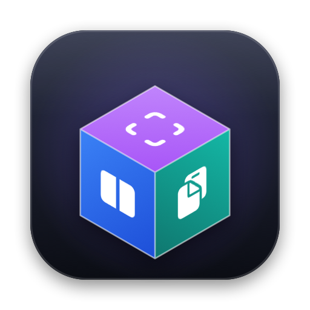

<p align="center"></p>

<p align="center"><b>English</b> · <a href="README.ko.md">한국어</a></p>

# PolyMac

> Many Mac tools in one lightweight menu bar app.
> An open-source macOS utility that combines Spectacle · TRex · Snipaste · AppCleaner · Maccy · Hazel · "Open in Terminal" **into one light app**.

> **Current version 0.2.11** — clipboard pins now stay pinned and can be unpinned; English README. Download it from [GitHub Releases](https://github.com/beomzh/PolyMac/releases) or build it yourself → [Install](#install) · [Try it now](#try-it-now-build-from-source)
> The app is not notarized by Apple, so macOS blocks a downloaded zip as "damaged" the first time you open it → [If macOS blocks the first launch](#if-macos-blocks-the-first-launch) (installing with Homebrew skips this step)
> Features in "Usage" that are not built yet are marked **(planned)**. See the [Development status](#development-status) table for each module.
> Some features exist for Korean text (Korean filename fix, Korean OCR tuning). They stay out of the way if you don't need them.

---

## Contents

1. [Why](#why)
2. [Features at a glance](#features-at-a-glance)
3. [Try it now (build from source)](#try-it-now-build-from-source)
4. [Development status](#development-status)
5. [Install](#install)
6. [First-time setup (permissions)](#first-time-setup-permissions)
7. [Usage](#usage)
8. [Troubleshooting](#troubleshooting)
9. [Privacy & security](#privacy--security)
10. [Versions & releases](#versions--releases)
11. [License](#license)
12. [Documentation](#documentation)

---

## Why

| What I used | The problem |
|---|---|
| Spectacle (window layout) | Repository archived in 2022; support for new macOS versions is uncertain |
| TRex (OCR) | Separate from the capture tool, so "capture → pin → extract text" is broken up |
| Snipaste (capture & pin) | Closed source, features arrive late on macOS, no OCR |
| AppCleaner (uninstall) | Doesn't show what was left where and why, yet still costs resources |
| Finder extensions | Cut, open in Terminal, and copy path are each a different app |
| Maccy (clipboard) | Disconnected from capture, OCR and copy-path results, so the source is unknown |
| Hazel (folder rules) | Paid, and watches folders separately from other tools |
| (none) Korean filenames | Korean filenames sent from a Mac show up as `ㅎㅏㄴㄱㅡㄹ` on Windows and the web |

Several apps = several menu bar icons, several permission prompts, shortcut conflicts managed in several places, and several times the memory.

## Features at a glance

| Module | Features | How it runs |
|---|---|---|
| **Window** | Shortcut window layout (½, ⅓, ¼, maximize, next display), snap by dragging to edges | Resident (light) |
| **Capture** | Area/window/full capture, **pin on screen**, non-destructive markup (editable later) | Resident (waits for shortcuts only) |
| **OCR** | Capture straight to text on the clipboard, mixed Korean/English, QR, URL and table recognition | Loaded when needed |
| **Clipboard** | Clipboard history: search, pin, text, images and files, password apps excluded automatically | Resident (light) |
| **Finder** | Real `⌘X` cut, open Terminal here, open in editor, copy path, send to a chosen folder | Resident (listens for events only) |
| **Normalize** | **Automatically fixes decomposed (NFD) Korean filenames**, converts copied text to NFC, Windows-friendly zip | Resident (FSEvents watch only) |
| **Organize** | Downloads auto-organize: build your own condition + action rules, turn each rule on or off | Resident (off by default) |
| **Uninstaller** | Shows app leftovers **by location, kind and confidence** and moves them to the Trash, finds **leftovers of apps already removed** | **Runs only while its window is open**, released when closed |

Each module can be turned on or off in Settings, and modules that are off are not loaded into memory.

**Targets**: idle memory < 40 MB · idle CPU 0% · capture → OCR → clipboard < 500 ms

## Try it now (build from source)

Builds with **Command Line Tools only**, no Xcode needed.

**1. Build and install**

```bash
git clone https://github.com/beomzh/PolyMac.git && cd PolyMac
```

```bash
scripts/build-app.sh --install
```

It installs to `/Applications/PolyMac.app` and launches. A PolyMac icon (a cube) appears in the menu bar. It normally stays out of the Dock; it shows in the Dock and `⌘Tab` only while Settings, the Welcome Guide or the Uninstaller window is open. If that window goes behind another app, click the Dock icon to bring it back.

**2. Grant permissions** — Menu bar PolyMac icon › **Settings…** (`⌘,`) › Permissions. Click "Allow…" next to an item with a warning to open the matching System Settings page. If a feature you turned on is missing a permission, "Permissions needed…" appears at the bottom of the menu.
- Accessibility: window layout, Finder `⌘X`, clipboard auto-paste
- Screen Recording: capture, OCR (after allowing, quit PolyMac once and open it again)
- After granting a permission, turn the feature off and on in the menu to apply it right away (especially Finder Tools).

**3. (Recommended) Create a stable certificate** — Without a certificate the app is ad-hoc signed, so **macOS resets its permissions on every rebuild**. Do one of the following and the build script finds and uses it automatically; permissions then stay.

- **Recommended — one script**: creates a 10-year self-signed certificate `PolyMac Beomzh` in your login keychain. You choose a backup password, and macOS asks once for your password (Touch ID) to set trust. Move the backup file (`~/Documents/PolyMac-signing.p12`) somewhere safe.
  ```bash
  scripts/make-signing-cert.sh
  ```
- **Create it by hand**: Keychain Access › menu **Keychain Access › Certificate Assistant › Create a Certificate…** → name `PolyMac Local` (the build script picks up names starting with `PolyMac `), Identity Type **Self Signed Root**, Certificate Type **Code Signing**, turn on "Let me override defaults" and set a long validity (for example 3650 days)
- **Xcode's Apple Development certificate** also works, but the signature reveals your email and name, and it expires every year. Don't use it for apps you give to others.

Then run `scripts/build-app.sh --install` → [reset permissions](#troubleshooting) and allow them once more. (If a keychain access prompt appears the first time you sign, choose "Always Allow".)

### Shortcuts that work today

| Shortcut | Action |
|---|---|
| `⌥⌘←` / `⌥⌘→` | Left / right half — press again for ⅓ → ⅔ |
| `⌥⌘↑` / `⌥⌘↓` | Top / bottom half |
| `⌥⌘F` / `⌥⌘C` | Maximize / center |
| `⌃⌥⌘→` / `⌃⌥⌘←` | Next / previous display |
| `⌥⌘Z` | Undo window position |
| `⌃⇧1` | Capture area → **editing toolbar** (box, arrow, pen, text, mosaic, numbers, extract text, pin, save, copy) |
| `⌃⇧2` | Select area → **extract text** → clipboard (Korean/English, QR) |
| `⌃⇧3` | Capture area → **pin on screen** right away |
| `⌃⇧4` | Clipboard image → pin on screen |
| `⌃⇧5` | Clipboard image → **extract text** (works for images from other capture apps too) |
| `⌃⇧6` | Select area → **extract table** (paste cell by cell into Excel or Numbers, or as a Markdown table — macOS 26 or later) |
| `⌃⇧7` | Select area → **translation** result window (on-device, macOS 15 or later) |
| `⇧⌘V` | Clipboard history window (search · full preview · source app) |
| `⌘X` → `⌘V` | Cut files in Finder → paste (move) — inside Finder only |
| `⌃⌥T` | Open Terminal in the current Finder folder (terminal app selectable) |
| `⌃⌥E` | Open the Finder selection (or the current folder) in an editor (editor app selectable) |
| `⌃⌥C` | Copy paths of the Finder selection (Korean in NFC) |

**Capture editing toolbar** (appears below the area after you select it with `⌃⇧1`)

| Tool | Key |
|---|---|
| Box / arrow / pen | `R` / `A` / `P` (press again to deselect) |
| Text / mosaic / numbers | `E` / `M` / `N` — text is typed right where you click. Hover to see a faint preview of where it goes, or double-click inside the area without choosing a tool. `↩` done, `⇧↩` new line, `Esc` cancel. Drag placed text to move it, drag a corner to resize, double-click to edit, `⌫` to delete (arrow keys move 1px, `⇧` 10px). Mosaic: drag over what to hide. Numbers: 1, 2, 3… on each click |
| Color | The 8 dots on the toolbar or `1`–`8` — red (default), orange, yellow, green, blue, purple, black, white |
| Undo | `⌘Z` |
| Extract text / pin on screen / save | `T` / `F` / `⌘S` |
| Extract table / translate (table macOS 26, translation macOS 15 or later) | `G` / `L` |
| Copy and finish / cancel | `↩︎` or `⌘C` / `Esc` |

Letter shortcuts (R, A, P, T, F, C and so on) follow key positions even when a Korean input source is active.

**Capture screen** — the screen dims, the cursor becomes a crosshair, and the keys available at that step appear at the bottom left.
- **Magnifier**: 15×15 pixel zoom next to the cursor, coordinates, and the color at that point (RGB/HEX). `C` copies the color, `⇧` switches RGB↔HEX
- **Size**: pixel size at the top left of the selection
- **Adjust the area** (after selecting): drag inside to move, drag **anywhere on the border** to resize (corners in two directions), arrow keys move 1px (`⇧` 10px), `⌘A` whole screen

**Window detection** — while selecting, the window under the mouse gets a blue outline. **Just click to select that window's exact frame**, or drag to choose your own area. When the capture ends, focus returns to the app you were using.

Without a tool selected, dragging outside the area selects a new area (once you have drawn markup, the area stays). Text extraction reads the original image, without your markup.

**Pins** — drag to move · `⌘`+drag to drop a PNG into another app · drag an edge or corner, scroll, or pinch to resize · `⌥`+scroll for opacity · right-click › Click-Through (turn off from the menu bar) · menu bar › Pin a Recent Capture
Close: hover over the pin and press `Esc` · click the pin, then `Esc`/`⌫` · double-click · right-click › Close (`⌫` is only taken after you click the pin, so it never deletes text in another app). `⌘C` on a clicked pin copies it
Right-click › **Markup** lets you add or undo boxes, arrows, pen, text, mosaic and numbers after pinning (markup is kept separately, not baked into the image). Copy and save use the image with markup; text extraction uses the original.
Right-click › **Select Text** lets you drag over text on the pin to pick part of it (Live Text, processed on your Mac only). After selecting, `⌘C` copies the text; with nothing selected it copies the image. While it is on, the border is green and dragging doesn't move the pin. Finish: `Esc` or right-click › Finish Text Selection.

**Clipboard history window** (`⇧⌘V`)
- Normally a **compact list**: app icon + one-line summary (line breaks shown as ⏎) or an **image thumbnail**, with `⌘1`–`⌘0` on the right (top 10)
- The button at the top right or `⌘→` **slides a preview panel open beside it** (`⌘←` to close, remembers the last state): full text (partly selectable) or a large image, with the source app, time, and character count or resolution below
- Search: content, app name and source tag; several words separated by spaces; "image" for images only, "rich" for formatted text only. Matches are highlighted in yellow in the list (shown from near the match) and in the preview, and the preview scrolls to the first match. Long text is searched only in its first 4,000 characters
- `↑↓` move · `↩︎`, double-click, `⌘1–9`, `⌘0` **copy to clipboard** · `⇧↩︎` copy and paste into the app in front · `⌥↩︎`/`⌥⇧↩︎` copy/paste **as plain text** · `⌘↩︎` pin an image on screen · `⌘P` pin/unpin · `⌘⌫` delete · `Esc` close · clicking elsewhere closes it
- **Formatting is kept too**: when formatting such as bold, color or links (RTF, and the HTML that Chrome and others add) is copied along, it is stored with the text, so formatting and links survive when you copy it again (formatting icon in the list, up to 5 MB combined). PolyMac doesn't interpret the formatting; it only stores it and puts it back.
- Copies that contain only a URL, such as Safari's right-click › Copy Link, are recorded as text.
- **Source tags**: things PolyMac copied show an icon for the feature they came from (text extraction · capture · copy path · color).
- **Paste the current clipboard as plain text**: no default shortcut (many apps already use `⌥⇧⌘V` for this). Set one in Settings › Shortcuts and it pastes plain text in any app.
- **Images are recorded too** (captures, copied photos — up to 30 MB each). Identical images are stored once
- **Keep for**: Menu bar PolyMac icon › Clipboard History › Keep for (1 / 3 / **7** / 30 days / no limit). Expired items are checked and removed every hour
- **Number kept**: same menu › Keep (50 / 100 / **200** / 500 / 1000 items). Over the limit, the oldest go first even within the period
- Pinned items are exempt from both limits, and removing an item also deletes its image or text file
- **Long text (logs and so on) is kept in full**: over 64 KB, the whole text is stored in a separate file and the list keeps only the beginning. Copying puts the whole text back, and the preview shows up to the first 200 KB. Up to 20 MB per item
- It doesn't take focus from the app you were using, so choosing with `⇧↩︎` pastes straight into that app

**About cutting in Finder** — macOS Finder has no file cut. Selecting files and pressing `⌘X` does nothing (Edit › Cut is disabled); it only cuts text while you edit a name. The built-in way to move is `⌘C` → `⌥⌘V` in the destination folder. Inside Finder only, PolyMac sends `⌘C` for `⌘X`, and `⌥⌘V` for the following `⌘V`. Both keys can be changed or turned off in the shortcut settings.

Steps:
1. In Finder, click files or folders to **select** them (not while a name is being edited — then it cuts text)
2. `⌘X` → if "✂️ n item(s) cut — press ⌘V in the destination folder" appears at the bottom of the screen, it worked
3. Open the destination folder in a Finder window (visiting another app in between is fine)
4. Click that Finder window to bring it forward and press `⌘V` → the files are **moved** (`⌘Z` undoes it)

Copying something else after `⌘X` cancels the cut, and `⌘V` becomes a normal paste. If nothing appears in step 2, check Accessibility in Settings › Permissions, and run `log stream --predicate 'subsystem == "dev.polymac" AND category == "finder"'` to see which step it got through (key contents are not logged).

**Choose a terminal app** — Settings › Finder Tools, or Menu bar PolyMac icon › Finder Tools › Terminal app. Only installed apps are listed (Terminal, iTerm2, Ghostty, Warp, WezTerm, Alacritty, kitty).

**Choose an editor app** — Settings › Finder Tools, or Menu bar PolyMac icon › Finder Tools › Editor app. Only installed apps are listed (Visual Studio Code, Cursor, Zed, Sublime Text, Nova, BBEdit, CotEditor, TextEdit). For an app not on the list, use **Choose Another App…**. At first, the first installed app in that order is used. Apps that can't open folders (CotEditor, TextEdit) get the files only, and PolyMac tells you how many folders were left out.

**Closing PolyMac windows** — the shortcut settings and Uninstaller windows close with `Esc` or `⌘W`. `⌘Q` closes only the PolyMac window if one is open, and quits PolyMac only when no window is open (it does nothing during a capture).

**Settings** — Menu bar PolyMac icon › **Settings…** (`⌘,`). There are seven tabs.

| Tab | Contents |
|---|---|
| Features | Turn each feature on or off (off unloads it from memory and releases its shortcuts), open at login, data folder |
| Language | Use system language / 한국어 / English — changes immediately |
| Notifications | Show notifications (off also hides permission and failure notices), position (bottom center, bottom left/right, screen center, top center, top left/right), display time (1–10 s, default 2 s — longer notices scale with it), text and background color — for each, "System" (follows light/dark mode, default) / 6 swatches / Custom (color panel, background can be transparent), font size (10–28 pt), maximum width (240–800 pt), padding — changes preview immediately, "Restore Defaults" |
| Finder Tools | Choose the apps for Open Terminal Here and Open in Editor (same setting as the menu's Finder Tools › Terminal app/Editor app). You can choose even while the feature is off |
| Korean Filenames | Add, remove, or turn off folders checked for decomposed Korean names; restore the defaults (Downloads, Desktop) |
| Auto-Organize | Downloads auto-organize rules (turn on, add, delete, drag to reorder, conditions and actions, export and import), watched folders, preview mode, wait time after downloads — takes effect only after **Save** (`⌘S`). You can edit while the feature is off |
| Shortcuts | See, change, and reset every shortcut |
| Permissions | Status of each permission, the features that use it, and links to System Settings |

**Change shortcuts** — Menu bar PolyMac icon › **Settings…** (`⌘,`) › Shortcuts. Click an item and press a new combination; it applies immediately.
- `Esc` cancel · `⌫` none · ↩︎ button restores the default · "Reset All"
- Combinations already used inside PolyMac are refused; combinations used by other apps get a warning.
- At least one of `⌘`, `⌃`, `⌥` is required (F keys can be used alone). Changes survive rebuilding and reinstalling the app.
- Finder cut and paste are on the list too ("inside Finder only"). If you change them, Finder uses the new combinations.

### Automatic Korean filename fix

When on, it changes NFD names to NFC for items **directly inside the checked folders** (the name looks the same, but no longer breaks on other systems). The default folders are Downloads and Desktop.

Change the folders: Menu bar PolyMac icon › **Settings…** (`⌘,`) › **Korean Filenames** to add, remove, or pause folders. Changes apply immediately.
- Only folders inside your home folder can be chosen; the home folder itself and `~/Library` (app data) are blocked. iCloud-synced folders are left alone even if listed.
- You can also set the same value (variable) from Terminal. It replaces the whole list, so include Downloads and Desktop if you want them. Turn the feature off and on after changing it.

```bash
defaults write dev.polymac.app normalize.folders -array "~/Downloads" "~/Desktop" "~/Documents/받은파일"
```

- `normalize.extraFolders` (extra folders) from older versions is moved into the new list automatically.

### Downloads auto-organize

**Off by default.** When you turn it on from the menu, it starts in **preview mode**: it only logs what it would do and moves nothing.

1. Menu bar PolyMac icon › Settings › Features › Downloads Auto-Organize
2. **Settings…** (`⌘,`) › **Auto-Organize** tab (the menu's Downloads Auto-Organize › **Edit Rules…** opens this tab too) → check the rules you want in the list on the left (the 5 built-in rules all start off) or create one with `+`, choose conditions and actions on the right, then **Save** (`⌘S`). Watched folders, preview mode and the wait time after downloads are in the same window.
3. Check the preview results in **Show Log**
4. If it looks right, uncheck **Preview Mode** → it runs for real. If something went wrong, undo the last run

In preview mode, menu › **Run Now** shows the files and actions in a confirmation dialog. **Organize** runs it for real this once (preview mode stays on); **Cancel** only logs it. If no file matches, a "Nothing to organize" notice appears. Watching and the hourly automatic run keep only logging while preview mode is on.

To edit JSON directly, use **Edit Rules File (JSON)…** and then **Reload Rules File**. One rule looks like this (add it to the `rules` array in `~/Library/Application Support/PolyMac/organize.json`):

```json
{
  "actions" : [
    { "move" : { "to" : "~/Documents/{domain}/{yyyy}-{MM}" } },
    { "rename" : { "template" : "{yyyy}{MM}{dd}_{name}" } }
  ],
  "conditions" : [
    { "sourceDomain" : { "domains" : [ "*.gov" ] } },
    { "nameMatches" : { "isRegex" : false, "pattern" : "*application*" } }
  ],
  "id" : "6F1C2A4E-0000-4000-8000-000000000001",
  "isEnabled" : true,
  "match" : "all",
  "name" : "Government applications go to Documents with a date",
  "stopAfterMatch" : true
}
```

| Condition key | Value |
|---|---|
| `fileExtension` | `{ "extensions": ["pdf", "hwp"] }` |
| `kind` | `{ "kinds": ["image"] }` — image, video, audio, document, archive, installer, code, other |
| `nameMatches` | `{ "pattern": "*invoice*", "isRegex": false }` |
| `sourceDomain` | `{ "domains": ["github.com", "*.go.kr"] }` |
| `sizeGreaterThan` / `sizeLessThan` | `{ "bytes": 104857600 }` |
| `addedMoreThan` / `notOpenedFor` | `{ "days": 7 }` |
| `isDuplicate` | `{}` — numbered like `name (1).pdf` and identical in content to the original |
| `allFiles` | `{}` — every file in the watched folder |
| `not` | `{ "condition": { ...one condition above... } }` |

| Action key | Value |
|---|---|
| `move` / `copy` | `{ "to": "~/Folder/{yyyy}-{MM}" }` — destinations outside your home folder are refused |
| `rename` | `{ "template": "{yyyy}{MM}{dd}_{name}" }` — the extension is kept automatically |
| `trash` | `{}` — to the Trash (never deleted permanently) |
| `addTag` | `{ "name": "Work" }` |
| `notify` | `{}` — notify only, don't touch the file |

Each rule needs its own `"id"` (you can make one with `uuidgen` in Terminal).

### Where data is stored

Everything is in `~/Library/Application Support/PolyMac/` (folder 0700, files 0600) — Settings › Features › Data folder "Show in Finder"

| File | Contents |
|---|---|
| `clipboard.json` | Clipboard history list (up to the number kept, plus pinned items; encrypted) |
| `clipboard-images/` | Images copied to the clipboard (encrypted PNGs, removed with their history item) |
| `clipboard-texts/` | Full contents of text longer than 64 KB (encrypted, removed with their history item) |
| `clipboard-rich/` | RTF and HTML of formatted text (encrypted, removed with their history item) |
| `organize.json` | Auto-organize rules |
| `organize-log.txt` | Auto-organize log (including preview) |
| `uninstall-log.txt` | Uninstaller log (paths moved to the Trash) |

When a log file (`*-log.txt`) passes 1 MB, it is renamed like `organize-log.1.txt`, only one old file is kept, and a new log starts. So each log is about 2 MB at most.

**Clipboard history is stored encrypted.** `clipboard.json`, `clipboard-images/`, `clipboard-texts/` and `clipboard-rich/` are sealed with AES-GCM, so other programs running as the same user can read the files but not their contents. The key is not on disk but in the login keychain ("PolyMac 클립보드 기록 암호화 키"), and only PolyMac signed with the same certificate can take it out.
- macOS ties this keychain item to each exact build, so after every update or rebuild macOS asks once for your login password. Choose "Always Allow" and it won't ask again until the next build.
- Older unencrypted history is sealed and rewritten once on first launch. (Because of how SSDs work, old plain text may remain in free space on the disk; turn on FileVault for full-disk protection)
- If the keychain is locked or access is denied, no new key is created, and for that run history is not written to disk (text stays in memory only).
- If you delete the key from the keychain, the old history can't be opened — the unreadable list is not deleted but kept next to it as `clipboard.unreadable-…json`, and a new one starts.

## Development status

| Module | Status | Works now | Not yet |
|---|---|---|---|
| Core | Working | Module on/off, global shortcuts + **settings screen**, permission guidance, notices, open at login, Settings (features, language, shortcuts, permissions) | — |
| Window | Working | Halves, ⅓, ⅔, quarters (shortcuts set by you), maximize, center, move between displays, undo, snap by dragging to edges (halves, maximize, quarters) | — |
| Capture | Working | Area capture, window detection, magnifier and color copy, move/resize the area, editing toolbar (box, arrow, pen, text, mosaic, numbers), pins + re-editable markup, save, pin click-through, `⌘`-drag to export, re-pin the last 10 captures | - |
| OCR | Working | Korean/English recognition, QR, NFC copy, clipboard image recognition, line-break handling (as shown, paragraphs, single line), small-text boost and symbol cleanup, accuracy benchmark, table recognition (macOS 26+, TSV and Markdown), Shortcuts actions (App Intents), `polymac://` integration (must be allowed), indentation kept, link open button, Live Text on pins, on-device translation (macOS 15+) | - |
| Clipboard | Working | Text (including long logs), image and file history, compact list + slide-out preview, search, source app, pinning, retention period (default 7 days) and count, password exclusion, per-app exclusion, encrypted storage, formatting (RTF) kept, paste as plain text, source tags, pin images on screen (`⌘↩`) | - |
| Finder | Working | Cut (shortcut changeable), open Terminal (app selectable), open in editor (app selectable), copy path, right-click menu (Services), send to a chosen folder, pending-cut indicator | - |
| Normalize | Working | Automatic NFC in Downloads and Desktop, right-click fix (including subfolders), Windows-friendly zip, fixing decomposed Korean in copied text | - |
| Organize | Working | Rule engine, watch/run/preview/undo, rule editor (JSON editing too, drag to reorder), rule export/import, duplicate detection, background scanning, placeholder autocomplete and preview | - |
| Uninstaller | Working | Finds leftovers of installed apps (certain, likely, possible), leftovers of removed apps, moves to the Finder Trash, quits running apps and unloads background items, `pkgutil --forget` for install receipts, saves the list before deleting | — |

Design: design only · Partial: partly working · Working: main features work — detailed plan in the [ROADMAP](docs/ROADMAP.md)

## Install

### Install the app (download)

Download `PolyMac-X.Y.Z.zip` and `PolyMac-X.Y.Z.zip.sha256` from [GitHub Releases](https://github.com/beomzh/PolyMac/releases). To check the download wasn't tampered with, run this in the folder with both files:

```bash
shasum -a 256 -c PolyMac-X.Y.Z.zip.sha256
```

If it prints `OK`, unzip it, move `PolyMac.app` to `/Applications`, and open it. (Opening it straight from Downloads makes macOS run it from a temporary location, and permissions don't attach properly.)

#### If macOS blocks the first launch

PolyMac is not notarized through the (paid) Apple Developer Program; it is signed with its own certificate (`PolyMac Beomzh`). macOS doesn't know this certificate, so the first time you open a PolyMac downloaded from the internet it shows **"'PolyMac' is damaged and can't be opened"**. The file isn't actually damaged (the sha256 check above shows that), and this dialog has no "Open Anyway". All the source is public, and the app doesn't connect to the internet unless you turn on update checks ([Privacy & security](#privacy--security)). If you trust it:

1. Click **Cancel** in the dialog. Don't click **Move to Trash**.
2. Remove the download mark (quarantine) in Terminal:

```bash
xattr -dr com.apple.quarantine /Applications/PolyMac.app
```

3. Open PolyMac again. It won't ask again.

- New versions installed with the in-app **Check for Updates…** are installed only after the PolyMac signing key (EdDSA) is verified, and are not blocked again.
- Installing with Homebrew removes this mark for you. An app you built yourself didn't come from the internet, so it skips this step.

#### Install with Homebrew

Homebrew's official repository doesn't accept apps that aren't notarized, so PolyMac is offered from a personal tap ([beomzh/homebrew-tap](https://github.com/beomzh/homebrew-tap)):

```bash
brew tap beomzh/tap
```

```bash
brew trust --cask beomzh/tap/polymac
```

```bash
brew install --cask beomzh/tap/polymac
```

From Homebrew 7, casks outside the official repository must be trusted once with `brew trust` before use (only this cask is trusted). The cask removes the download mark (quarantine) from the installed app, so it opens without the "damaged" dialog.

#### Updates

- Menu bar PolyMac icon › **Check for Updates…** looks for a new version on GitHub and installs it. A download is installed only if the PolyMac signing key (EdDSA) matches.
- To check automatically once a day, turn on Settings › Features › Updates › **Check for updates automatically**. It is off by default, and while it is off PolyMac doesn't use the network.
- If you installed with Homebrew, `brew upgrade --cask polymac` works too. You need the name — a plain `brew upgrade` skips it because the app updates itself.
- Apps you build yourself have no update check (`git pull` and rebuild).

### Build from source

To install the app, use `scripts/build-app.sh --install` from [Try it now](#try-it-now-build-from-source). The rest is for development.

Requirements: macOS 14 or later, Command Line Tools (`xcode-select --install`). Running `swift test` and building the Shortcuts actions (App Intents) need Xcode 16 or later — `scripts/build-app.sh` uses `/Applications/Xcode.app` automatically if it is there. On the first build, `scripts/fetch-sparkle.sh` downloads Sparkle (auto-update) and verifies its checksum.

```bash
git clone https://github.com/beomzh/PolyMac.git
```

```bash
cd PolyMac && swift build
```

```bash
scripts/test.sh
```

`scripts/test.sh` finds the installed Xcode and runs `swift test` (no need to change `xcode-select`).

When changing OCR settings, measure accuracy and compare ([docs/OCR-BENCH.md](docs/OCR-BENCH.md)):

```bash
scripts/ocr-bench.sh
```

## First-time setup (permissions)

macOS requires separate permissions for apps like this. PolyMac asks **only for the permissions the features you turned on need**.

**Welcome Guide** — on first launch, a guide opens: introduction → choose features → permissions → finish (common shortcuts, open at login). Reopen it any time from Menu bar PolyMac icon › **Welcome Guide…**.

**Permissions screen** — Settings › Permissions (`⌘,`) shows each permission's status (allowed · needs permission · not asked yet · asked on first use) and the features that are on and use it. Allowing it in System Settings is reflected immediately.
- Screen Recording takes effect only after PolyMac restarts — use the **Restart if allowed** button next to it
- For Automation › Finder, clicking **Allow…** makes macOS ask right away
- If a permission you allowed before is now off (for example after installing a new download whose signature changed), it tells you at the top of the screen and at launch
- **Reset permission records…** — for when it's on in System Settings but doesn't work. It clears only PolyMac's Accessibility, Screen Recording and Automation records and restarts (other apps are untouched). When it opens again, allow them again on the permissions screen.

| Permission | Where in System Settings | Needed by |
|---|---|---|
| Accessibility | Privacy & Security › Accessibility | Window, Finder (`⌘X`) |
| Screen & System Audio Recording | Privacy & Security › Screen & System Audio Recording | Capture, OCR |
| Automation › Finder | Privacy & Security › Automation | Finder shortcuts (open Terminal, open in editor, copy path — not needed for the right-click menu) |
| Files and Folders | Privacy & Security › Files and Folders | Normalize, Organize |
| Full Disk Access | Privacy & Security › Full Disk Access | (not requested — uninstalling is left to Finder) |
| Finder extension | General › Login Items & Extensions › Finder | Open Terminal and copy path menu items |

- The app works without permissions; only the affected features stay off, with a notice.
- From macOS 15, Screen Recording permission periodically asks to be confirmed again. This is system policy and the app can't prevent it.

## Usage

> The shortcuts below are **defaults**, and every one can be changed or removed in Settings › Shortcuts (the ⓧ button at the right of the row, or press the shortcut and then `⌫`). The settings screen warns you when one overlaps another app or system shortcut.

### Window layout — Window (0.1.0)

Matches Spectacle's default shortcuts, so moving over feels the same.

| Action | Shortcut |
|---|---|
| Left / right half | `⌥⌘←` / `⌥⌘→` |
| Top / bottom half | `⌥⌘↑` / `⌥⌘↓` |
| Maximize | `⌥⌘F` |
| Center | `⌥⌘C` |
| Next / previous display | `⌃⌥⌘→` / `⌃⌥⌘←` |
| Undo | `⌥⌘Z` |
| Top left · top right · bottom left · bottom right quarter | No default — set in Settings › Shortcuts |

- Repeating the same shortcut cycles the size ½ → ⅓ → ⅔.
- `⌥⌘C` (center) overlaps Finder's built-in "Copy path" shortcut. It matches Spectacle, but change it in settings if you copy paths in Finder often.
- Snap by dragging to edges (menu › Window Layout › Snap by Dragging to Edges, off by default): drag a window to the left or right edge of the screen for a half, the top edge to maximize, or a corner for a quarter; a preview appears and the window snaps when you let go. `⌥⌘Z` undoes it. macOS 15 and later have the same feature (System Settings › Desktop & Dock › Windows), so turn the system one off to use this.

### Capture · pin · markup — Capture (0.2.0)

| Action | Shortcut |
|---|---|
| Capture area | `⌃⇧1` |
| Capture and pin on screen | `⌃⇧3` |
| Pin clipboard image on screen | `⌃⇧4` |

1. `⌃⇧1` → the screen dims and **the outline of the window under the mouse is detected automatically**. Click for that window, drag for your own area.
2. While selecting, the magnifier shows **pixel coordinates and the color**. Press `C` to copy the color code.
3. After selecting, mark it up from the toolbar below with box, arrow, pen, text, mosaic and number stamps.
4. `Enter` copy to clipboard · `⌘S` save · `F` pin on screen · `T` extract text · `G` extract table · `L` translate · `Esc` cancel

**Pins (pinned captures)**
- Resize: drag an edge or corner (keeps proportions, opposite side fixed) · scroll · trackpad pinch (20%–500%)
- `⌥` + scroll: opacity · double-click: close
- `⌘` + drag: **drop a PNG with markup into Finder, chat apps, Mail and so on** (the temporary file lives in your user temp folder and is deleted after an hour, or when the feature is turned off)
- Right-click menu: edit markup again · show on all desktops · **Click-Through** (click and scroll the window under the pin — the border turns orange; undo with menu bar › Capture & Pin › Turn Off Click-Through. `Esc` over the pin still closes it)
- Menu bar › Capture & Pin › **Pin a Recent Capture**: shows the last 10 as thumbnails and re-pins the one you choose, markup included. Kept in memory only, never written to disk, so they disappear when PolyMac quits.
- Image items in the clipboard history can be pinned with `⌘↩` too.
- Markup is stored separately rather than baked into the picture, so **you can open and change it later.**

### Text recognition — OCR (0.3.0)

| Action | Shortcut |
|---|---|
| Select area → text straight to the clipboard | `⌃⇧2` |
| Clipboard image → text | `⌃⇧5` |
| Select area → table to the clipboard | `⌃⇧6` |
| Select area → translate (macOS 15 or later) | `⌃⇧7` |

- The result is shown briefly in a notice (title centered in bold, recognized text in the box below). QR codes and barcodes are read and copied too.
- If the recognized text contains a web address, the notice shows an **Open: address** button (up to 3, http and https only). It opens in your default browser only when you click it, never by itself — because anyone can make a QR code or on-screen text.
- Copy part of the text on a pin by dragging over it: right-click the pin › Select Text
- (planned) Click the notice to correct the text and copy again
- Settings
  - Languages: recognized in the order Korean → English (putting English first makes it miss almost all Korean, so this isn't changed — [measurements](docs/OCR-BENCH.md))
  - Small-text boost: captures of 2 MP or less are read at 2× size, and `•` between Korean text becomes `·`, `•·•` becomes `…`
  - Line breaks (menu › Text Recognition (OCR) › Line breaks): Keep lines as shown (default) / Join into paragraphs (joins lines broken mid-sentence, as in PDFs and web pages, and breaks only between paragraphs) / Single line (for search boxes and translators). English end-of-line hyphens (`recog-` + `nition`) are joined.
  - Indentation kept: with "Keep lines as shown", leading spaces in code, YAML and lists are kept (most accurate with monospaced fonts. Differences under two spaces and text in several side-by-side columns are left as is — [measurements](docs/OCR-BENCH.md))
- **Translation** (macOS 15 or later, `⌃⇧7` or menu › Text Recognition (OCR) › Translate Clipboard Text) — Apple's on-device translation. Text not in your language is translated into your language, and text in your language into English, then shown in a result window. Compare the translation with the original; the clipboard changes only when you click **Copy Translation** (`↩`) or **Copy Original**. Select part and press `⌘C` to copy only that part. `Esc` closes it. Line breaks, indentation and list markers are kept and each line is translated; sentences broken by the screen width are joined before translating. Code doesn't translate well. The first time, macOS asks whether to download the languages (the system does the download; the text you translate never leaves the device).
- **Table extraction** (macOS 26 or later, `⌃⇧6`, the table button (`G`) on the capture toolbar, or menu › Text Recognition (OCR) › Extract Table from Clipboard Image)
  - Table format (menu › Text Recognition (OCR) › Table format): **Excel / Numbers** (default, tab-separated text — pasting into Excel, Numbers or Google Sheets splits it into cells; Pages and Notes get a table) / **Markdown table** (first row is the header)
  - Merged cells put the text only in the top-left cell and leave the rest empty. Line breaks inside a cell become a space.
  - If no table is found, it copies plain text. On macOS 14–15 it always copies plain text.
  - Measured: on 6 synthetic tables, rows and columns 6/6, cells 95.8% match ([measurements](docs/OCR-BENCH.md#표-인식)). Key symbols such as `⌃⇧` are read poorly.
- **Call it from Shortcuts** — off by default. Turn on menu › Text Recognition (OCR) › **Allow Shortcuts & URLs** for it to work (because a web page link could also call it).
  - `polymac://ocr`: clipboard image → text on the clipboard
  - `polymac://ocr-table`: clipboard image → table on the clipboard (choose the format with `?format=markdown` or `?format=tsv`; without it, the menu setting is used)
  - Shortcut example: "Take Screenshot" (or the clipboard image) → **Open X-Callback URL** `polymac://x-callback-url/ocr` → "Get Clipboard". Called through X-Callback, it returns to Shortcuts when recognition finishes.
  - It reads only the clipboard image and puts results only on the clipboard. The return address it opens afterwards is limited to `shortcuts://`.
- **Actions in the Shortcuts app** — search for "PolyMac" in the Shortcuts app to find ready-to-use actions. Results are returned to the shortcut and the clipboard isn't touched. No separate permission is needed (web pages can't call them), but they don't work while the matching feature is off. Only included in apps built with Xcode.
  - **Extract Text from Image** · **Extract Table from Image** (Excel, Markdown): reads the clipboard image if no image is passed
  - **Extract Text from Screen Area**: shows the area selection screen (Screen Recording permission)
  - **Compose Decomposed Korean**: takes text and returns it with only decomposed (NFD) Korean composed

### Clipboard history — Clipboard (0.4.0)

| Action | Shortcut |
|---|---|
| Open history | `⇧⌘V` |
| Copy the selected item / paste right away | `↩` / `⇧↩` (pasting needs Accessibility permission) |
| Copy / paste as plain text | `⌥↩` / `⌥⇧↩` |
| Pick the 1st–10th item from the top | `⌘1` – `⌘0` |
| Pin / unpin | `⌘P` |
| Pin an image item on screen | `⌘↩` (Capture & Pin must be on) |
| Delete | `⌘⌫` |
| Open / close the preview | `⌘→` / `⌘←` |

- Start typing while the list is open to search.
- What's recorded: text (up to 20 MB, long logs kept in full), images, and **files and folders copied in Finder** (only the paths — choosing one puts it back as a file to paste with `⌘V` in Finder).
- Each item shows the icon of the app it was copied from; PolyMac's text extraction, capture, copy path and color copy get a source tag, and formatted text gets a formatting icon.
- **Not recorded**: copies a password manager marks as "concealed", Keychain Access, Passwords, 1Password, Bitwarden, and apps you exclude.
- **Exclude an app**: with that app in front, menu bar › Clipboard History › **Don't Record From** › "Don't record copies from 'app name'". Click it again in the same menu to record again.
- Menu bar › Clipboard History › "Pause Recording" stops it for a while; the number kept and the period (default 200 items, 7 days) are also changed here.

### Finder tools — Finder (0.5.0)

**Cut / paste**

| Action | Shortcut |
|---|---|
| Cut | `⌘X` (after selecting files in Finder) |
| Paste to move | `⌘V` (in the Finder window of the destination folder) |
| Send to a chosen folder | Finder right-click › Quick Actions (or Services) › **PolyMac: Send to Folder…** — move or copy, remembers the last folder |
| Open in editor | `⌃⌥E` or Finder right-click › Services › **PolyMac: Open in Editor** — folders open as the editor's workspace |

- After `⌘X`, **"✂️ n item(s) cut — press ⌘V in the destination folder"** stays at the bottom of the screen until you move them (shown only while Finder is in front). It disappears after the move.
  - Cancel: the ⓧ button on the indicator, copying something else, or just `⌘C`. The files stay put and `⌘V` makes a copy.
  - If the indicator bothers you, turn off menu › Finder Tools › **Show Pending Cut at Bottom of Screen** to get only a brief notice as before.
  - From the clipboard, it reads only the number of files, never their names.
- Finder does the actual move, so **`⌘Z` undo**, the name conflict dialog and the progress display all work as usual.
- `⌘X` while editing a file name cuts text as usual.
- For detailed steps and what to check when it doesn't work, see the Finder cut section in "Try it now" above.

**Open Terminal · copy path** — shortcuts `⌃⌥T` / `⌃⌥C`, or Finder right-click › Quick Actions (or Services) › **PolyMac: Open Terminal Here / Copy Path** (the right-click menu works without Automation permission)
- Terminal app: Terminal / iTerm2 / Ghostty / Warp / WezTerm / Alacritty / kitty (installed ones only)
- Copy path: several paths separated by line breaks, Korean in NFC

> Note: macOS can also copy a path in Finder with `⌥⌘C` on its own.

### Korean filename fix — Normalize (0.5.0)

Prevents Korean filenames made on a Mac from breaking into `ㅎㅏㄴㄱㅡㄹ` on Windows or in web uploads.

- **Automatic**: fixes the names of files that arrive in watched folders (default: Downloads, Desktop, the screenshot folder). Add or exclude folders in settings.
- **Manual**: Finder right-click › **PolyMac: Fix Korean Filenames** → shows how many will change first, then converts after you confirm, including subfolders (inside apps and bundles, hidden files and .git are left alone).
- **Zip**: Finder right-click › **PolyMac: Compress for Windows** → changes names to NFC and turns on the zip "UTF-8 names" flag, creating a zip next to it whose Korean names are correct on Windows too. `.DS_Store` and `__MACOSX` are left out (up to 4 GB). The built-in macOS compression doesn't set this flag, so names break on Windows.
- **Copied text**: decomposed Korean (`ㅎㅏㄴㄱㅡㄹ`) copied from Finder filenames and elsewhere is composed and put back on the clipboard. Copy path (`⌃⌥C`) puts composed Korean from the start.
  - Only Korean jamo sequences are changed; other characters (such as CJK compatibility ideographs) are left as is. Formatting (RTF, HTML) is fixed too.
  - Concealed items like passwords, and files copied in Finder (the `⌘X` cut needs to recognize that copy), are not touched.
  - Turn off: menu › Korean Filename Fix › **Also Fix Decomposed Korean in Copied Text**. Works only while this feature is on.
- These places are **left alone** by default: git repositories, iCloud Drive and Dropbox folders, inside app bundles, `~/Library`, external disks in the old format (HFS+).

### Downloads auto-organize — Organize (0.6.0)

Everyone organizes differently, so **you build the rules yourself**. The whole feature, each watched folder, and each rule can be turned on or off separately.

**Rule = conditions + actions**

| Condition | Example |
|---|---|
| Extension | `pdf`, `hwp` |
| File kind | image · video · audio · document · archive · installer · code |
| Name pattern | `*invoice*` or a regular expression |
| Source website | `github.com`, `*.go.kr` |
| Size | over 100 MB / under 1 MB |
| Downloaded more than | 7 days · 2 months · 1 year ago (unit: days, months or years; 1 month = 30 days · 1 year = 365 days) |
| Not opened for | 30 days · 6 months · 1 year (same units as above) |
| Duplicate | numbered like `name (1).pdf` or `name 2.pdf` and identical in content to the original file in the same folder |
| All files | every file directly in the watched folder (except files and folders still downloading) — a rule with no conditions matches nothing, so choose this to cover everything |
| Is not | inverts a condition above |

Conditions are combined with "all match" or "any match", and rules are checked from the top in order.

| Action | Example |
|---|---|
| Move / copy | `~/Documents/Received/{yyyy}-{MM}` |
| Rename | `{yyyy}{MM}{dd}_{name}` |
| Move to Trash | (permanent deletion is not supported) |
| Finder tag | `Work` |
| Notify only | doesn't touch the file, marks it as an "organize candidate" |

Values for paths and names: `{name}` file name · `{ext}` extension · `{kind}` kind · `{domain}` source website · `{yyyy}` `{MM}` `{dd}` date
- In the rule editor, insert them with the buttons below the folder and name fields; type `{` to narrow the list and click to complete.
- Below each field you see the result for a sample file (`보고서.pdf`, downloaded from example.com), and values not on the list (typos like `{date}`) are shown in orange.

**Example rule** — "Applications downloaded from government sites go to Documents with a date"
- Conditions (all match): source website `*.go.kr` + name pattern `*신청서*` ("application form")
- Actions: move `~/Documents/{domain}/{yyyy}-{MM}` + rename `{yyyy}{MM}{dd}_{name}`
- Result: `지원금 신청서.hwp` → `~/Documents/gov.go.kr/2026-10/20261027_지원금 신청서.hwp`

**Built-in presets** (all off, turn on the ones you want): Trash installers after 7 days · Documents into monthly folders · Images to Pictures · Folders by source website · Notify about files unopened for 30 days

**Safeguards**
- It starts in **preview mode**: nothing is moved, it only shows the list of what "would be organized". Turn it off after checking and it runs for real.
- Files being downloaded are left alone; it waits 10 seconds (changeable) after a download finishes. Even an old file is waited on again for the same time if it was **just overwritten or saved**, and files Finder is still copying are skipped.
- Folders are scanned in the background, and right before moving, each file's size and modification time are checked again. Files that changed after the scan are not touched this time; they are logged as "skipped" and checked again shortly. If more changes arrive during a scan, scans don't overlap; one more scan runs after it finishes.
- If the name already exists, nothing is overwritten; it saves as `name (2)`.
- You can **undo** any time from the log.
- Below the rule list, **More › Export Rules…/Import Rules…** exchanges a JSON file with just the rules (watched folders and preview mode are left out). `organize.json` can be imported too.
- Imported rules arrive **turned off**, and can be added after the current rules or replace them all. Check them, turn them on, and **Save** to apply. Files exported from a newer PolyMac version, files over 1 MB, and JSON that isn't a rules file are refused.

### App Uninstaller — Uninstaller

Menu bar PolyMac icon › **Uninstall an App…** at the top (for leftovers of apps already removed, use the **Leftovers** tab at the top left of the window, or menu › App Uninstaller › Find Leftovers of Removed Apps…). Closing the window unloads it from memory.

**Remove an installed app**
1. Choose from the list on the left (searchable, including folders under `/Applications`) or drag an app onto the window
2. The files left behind are grouped **by kind** with their sizes — app · app data · caches · preferences · sandbox data · shared data · window state · web data · logs · background items · privileged helpers · install receipts. Each kind comes with **an explanation of whether it's safe to remove**
3. Each item shows **why it was matched** and a grade
   - **Certain** — matches the app ID (`com.company.app`), or the developer team ID + app ID (selected by default)
   - **Likely** — data from the same developer, a background item that runs a program inside the app, a folder with the app's name, install receipts (selected by default)
   - **Possible** — only contains the app's name (not selected by default; check it in Finder with the magnifier button and select it yourself)
4. **Move to Trash** (`⌘⌫`) — if the app is running it is quit first, background items that run at login are unloaded, and then **Finder moves them to the Trash**
   - Recover them with **Put Back** in the Finder Trash
   - Items under `/Library` make Finder ask for an administrator password
   - **Install receipts** (pkg) are not moved to the Trash but removed with `pkgutil --forget` (a macOS password dialog appears once). Moving only the files would leave traces in the pkgutil list
   - Built-in macOS apps and PolyMac itself can't be removed
5. (Optional) **Export List…** — before removing, saves the path, size, modification date and reason of the selected items (or all) to a table file (.tsv)

**Leftovers of removed apps** — finds settings, caches and data left after an app was removed.
- Only app-ID-style names whose app **isn't on this Mac** (built-in `com.apple.*` excluded)
- Sub-items of installed apps (such as a `com.company.app.ShipIt` updater) are excluded
- Background items are **excluded if their program still exists** (so security software installed without an app isn't broken); if the program is gone they are "Likely"
- Files used by currently registered services (privileged helpers and so on) are excluded
- If another app from the same company is installed, it may be a shared component, so it is lowered to "Possible"

**What you see before removing**
- Each item's **last modified date** (including files inside), and for apps the **last used date** (Spotlight records)
- Items **in use** — if a running executable is inside it or a program has its files open, it shows "In use (program name)" and can't be selected. Quit that program and search again
- If an app sits in its own folder (`/Applications/Company/App.app`) with no other app in it, the **whole folder** becomes a candidate (installers and resources included). Folders that collect several apps are left alone
- Other apps' sandbox data (`~/Library/Containers/…`) is protected by macOS, so a "access data from other apps" prompt may appear when removing it

The criteria (every location searched, grade conditions, company name filter, exclusions) are in [docs/UNINSTALLER.md](docs/UNINSTALLER.md).

Removal log: `~/Library/Application Support/PolyMac/uninstall-log.txt`

## Troubleshooting

**If you move PolyMac to another folder (for example `/Applications/Downloads folder/`)**
- Permissions (Accessibility, Screen Recording) are tied to the signature, not the location, so they stay.
- Features and data (`~/Library/Application Support/PolyMac`) are not affected.
- **Open at login** may remember the old location, so turn it off and on in Settings › Features.
- `scripts/build-app.sh --install` always installs to `/Applications/PolyMac.app`. If a moved copy is left so there are two, both can run at once and shortcuts may clash, so delete one.


| Symptom | Fix |
|---|---|
| A shortcut doesn't work or another app reacts | Quit apps that use the same shortcut (Spectacle and so on). macOS doesn't always report conflicts with other apps, so shortcuts may overlap even without a warning in Settings › Shortcuts. Window layout needs Accessibility permission |
| It keeps asking for a permission you granted | Remove the PolyMac item with `-` in System Settings, restart the app, and allow it again. If you built it yourself, check that you sign with the same certificate every time ([RELEASING](docs/RELEASING.md) 6) |
| Asks for the login keychain password after every update or rebuild | That's the clipboard encryption key. macOS ties the keychain item to each exact build of a self-signed app, so it asks once per build. Choose "Always Allow". It's separate from Accessibility and Screen Recording, which stay |
| The screen seems frozen dark during a capture | `Esc` (works even when another app has focus) or right-click to cancel. Changes to the screen setup (connecting or disconnecting a monitor, closing the lid) cancel automatically, and so does 60 seconds passing |
| Captures are black or show only the desktop | Allow Screen Recording, then quit PolyMac → open it again |
| Allowed in settings but not working / permissions lost after a rebuild | An app whose signature changed (ad-hoc signed builds, a new version signed with another certificate) is treated as a different app, and the allowed entry in settings points to the **old app**. Use Settings › Permissions › **Reset permission records…** (or "Reset permissions" below) and allow them again. To stop this from repeating, create a [stable certificate](#try-it-now-build-from-source) |
| Finder `⌘X` only copies | Accessibility permission is missing. Once allowed, it turns on within 2 seconds and shows "⌘X cut is on". Check the status in PolyMac icon › Finder Tools |
| PolyMac is missing from the Finder right-click menu | Select an item, right-click, and look under Quick Actions or Services. If it's still missing, turn on the PolyMac items in System Settings › Keyboard › Keyboard Shortcuts › Services › Files and Folders, and open PolyMac from /Applications once more |
| Auto-organize doesn't work | Check that the module, watched folder and rules are all on, and whether preview mode is on |

**You made a certificate but the build says "no certificate, ad-hoc signing"** — the Apple intermediate certificate (WWDR G3) needed to validate it is missing from the keychain. Check:

```bash
security find-identity -v -p codesigning
```

If it says `0 valid identities found`, download the **Worldwide Developer Relations - G3** certificate (`AppleWWDRCAG3.cer`) from the [Apple PKI](https://www.apple.com/certificateauthority/) page, double-click it to add it to the keychain, and check again. When it says `1 valid identities found`, run `scripts/build-app.sh --install` in Terminal (the first time, a keychain access prompt → "Always Allow").

**Reset permissions** — clears only PolyMac's entries (other apps' permissions stay). Open PolyMac again afterwards and allow them.

```bash
tccutil reset Accessibility dev.polymac.app
```

```bash
tccutil reset ScreenCapture dev.polymac.app
```

**View logs** — please attach them when reporting a problem. Key presses and clipboard contents are never logged.

```bash
log stream --predicate 'subsystem == "dev.polymac"' --level info
```

## Privacy & security

- **It doesn't connect to the internet.** OCR, translation, organizing and the clipboard are all processed on your Mac, and no usage statistics are sent. The only exception is the **update check** you click or turn on (it fetches only new version information from GitHub and sends no device information).
- Key presses are used only to detect shortcuts and are never stored.
- It **never permanently deletes or overwrites files.** Everything removed goes to the Trash.
- It doesn't hold administrator rights, doesn't inject code into other apps, and doesn't ask you to disable System Integrity Protection (SIP).

Full principles: [docs/SECURITY.md](docs/SECURITY.md)

## Versions & releases

- Follows [Semantic Versioning](https://semver.org/). Until 1.0.0, each MINOR version is one stage of the [ROADMAP](docs/ROADMAP.md).
- Current version: the [`VERSION`](VERSION) file
- Development history: [CHANGELOG.md](CHANGELOG.md) · user-facing summary: GitHub Releases
- Each release lists **compatibility changes** and **newly requested permissions** separately.
- Detailed rules (branches, tags, release checklist, supported macOS policy): [docs/RELEASING.md](docs/RELEASING.md)
- How to contribute and commit message rules: [CONTRIBUTING.md](CONTRIBUTING.md)

The project documents under `docs/` are written in Korean.

## License

PolyMac is under the [MIT License](LICENSE).

**You may**: use it freely for personal, company or commercial purposes, modify it, redistribute it, and include it in other projects
**Condition**: include the copyright notice and license text from the `LICENSE` file when you redistribute
**No warranty**: the software is provided "as is", and the authors are not liable for problems arising from its use.

**Third-party code**
- [Sparkle](https://sparkle-project.org) (MIT) is distributed with the app for auto-update. Its copyright and license are in [THIRD_PARTY_NOTICES.md](THIRD_PARTY_NOTICES.md).
- Other open-source projects were consulted for structure and ideas; what was consulted and how, and the code use policy, are published in [docs/REFERENCES.md](docs/REFERENCES.md). No GPL or Commons Clause code is brought in.

**Trademarks**
- PolyMac is not affiliated with Apple Inc. and is not approved or sponsored by Apple. Mac, macOS and Finder are trademarks of Apple Inc.
- Other app names in this document (Spectacle, TRex, Snipaste, AppCleaner, Maccy, Hazel and so on) are trademarks of their owners and are mentioned only for comparison.

## Documentation

| Document | Contents |
|---|---|
| [docs/CONCEPT.md](docs/CONCEPT.md) | Concept, goals and non-goals, feasibility of each feature |
| [docs/ARCHITECTURE.md](docs/ARCHITECTURE.md) | Module structure, permissions, resource budget, technology choices |
| [docs/ROADMAP.md](docs/ROADMAP.md) | Development plan by version |
| [docs/SECURITY.md](docs/SECURITY.md) | Local-only security principles |
| [docs/RELEASING.md](docs/RELEASING.md) | Versioning and release rules |
| [docs/OCR-BENCH.md](docs/OCR-BENCH.md) | OCR accuracy samples, method, results, and the settings decided from them |
| [docs/UNINSTALLER.md](docs/UNINSTALLER.md) | App Uninstaller criteria (locations searched, grades, company name filter, exclusions) |
| [docs/REFERENCES.md](docs/REFERENCES.md) | Open source and APIs consulted, license checks, attribution policy |
| [CONTRIBUTING.md](CONTRIBUTING.md) | Development setup, commit rules |
| [THIRD_PARTY_NOTICES.md](THIRD_PARTY_NOTICES.md) | Copyright notices for third-party code |
