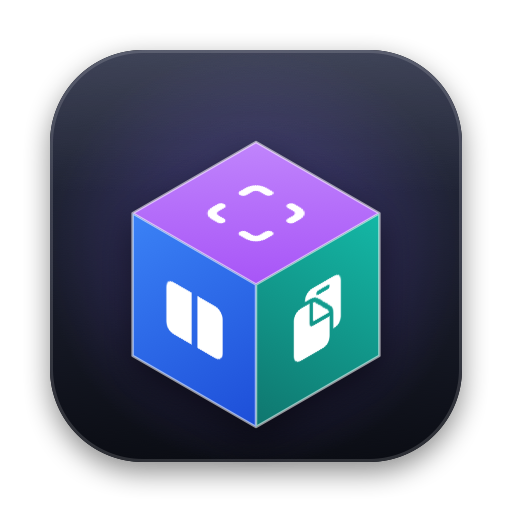

<p align="center"></p>

<p align="center"><a href="README.md">English</a> · <a href="README.ko.md">한국어</a> · <a href="README.ja.md">日本語</a> · <b>简体中文</b> · <a href="README.zh-Hant.md">繁體中文</a></p>

# PolyMac

> 众多 Mac 工具，集于一个轻巧的菜单栏应用。
> 一款开源 macOS 工具，把 Spectacle · TRex · Snipaste · AppCleaner · Maccy · Hazel ·“在终端中打开” **合并成一个轻巧的应用**。

> **当前版本 1.1.0** — 可从 [GitHub Releases](https://github.com/beomzh/PolyMac/releases) 下载，或用 Homebrew 安装。
> 本页为摘要版。快捷键列表、各功能的详细用法和故障排除请参阅 [英文 README](README.md)。
> 部分功能是为韩文准备的（如韩文文件名修复）。不需要时可以关闭。

## 功能

| 模块 | 功能 |
|---|---|
| **窗口布局** | 用快捷键将窗口排列为 ½、⅓、¼、最大化或移到下一个显示器；拖到边缘排列 |
| **截图与固定** | 区域、窗口、全屏截图，**固定在屏幕上**，可随后编辑的标注 |
| **文本识别（OCR）** | 截图后立即转为文本放入剪贴板；支持韩文、英文、日文、中文，以及二维码、URL、表格识别和本机翻译 |
| **剪贴板历史** | 搜索、固定，文本、图像和文件；自动排除密码管理应用 |
| **Finder 工具** | 真正的 `⌘X` 剪切、在此处打开终端、在编辑器中打开、复制路径 |
| **韩文文件名修复** | 自动修复被拆分（NFD）的韩文文件名，适用于 Windows 的 zip |
| **下载自动整理** | 用条件加操作的规则移动和重命名文件（默认关闭） |
| **应用卸载** | 按位置、种类和可信度显示应用残留文件并移到废纸篓 |

每个功能都可以在设置中开启或关闭，关闭的功能不会载入内存。

## 显示语言

在设置 › 语言 中可选择：跟随系统语言 / 한국어 / English / 日本語 / 简体中文 / 繁體中文，立即生效。“跟随系统语言”使用 macOS 的首选语言；如果该语言不在列表中，则使用英语。

文本识别（OCR）先按韩文和英文读取；如果没有找到韩文，会自动判断日文和中文（简体、繁体）再读取一次。

## 安装

### 下载

从 [GitHub Releases](https://github.com/beomzh/PolyMac/releases) 下载 `PolyMac-X.Y.Z.zip` 和 `PolyMac-X.Y.Z.zip.sha256`，在两者所在的文件夹中检查文件是否被篡改：

```bash
shasum -a 256 -c PolyMac-X.Y.Z.zip.sha256
```

显示 `OK` 后解压，把 `PolyMac.app` 移到 `/Applications` 再打开。

#### 首次打开被阻止时

PolyMac 未经 Apple 公证，而是用自己的证书（`PolyMac Beomzh`）签名。因此首次打开下载的版本时会显示 **“‘PolyMac’已损坏，无法打开”**。文件并没有损坏。如果你信任它，请在对话框中点击 **取消**（不要移到废纸篓），然后在终端中移除下载标记，再重新打开：

```bash
xattr -dr com.apple.quarantine /Applications/PolyMac.app
```

### Homebrew

```bash
brew tap beomzh/tap
```

```bash
brew trust --cask beomzh/tap/polymac
```

```bash
brew install --cask beomzh/tap/polymac
```

用 Homebrew 安装时不会出现上面的“已损坏”对话框。

### 更新

菜单栏 PolyMac 图标 › **检查更新…** 会从 GitHub 安装新版本，只安装与 PolyMac 签名密钥（EdDSA）匹配的版本。自动检查（每天一次）可在设置 › 功能 › 更新 中开启，默认关闭。

## 权限

PolyMac **只请求已开启功能所需的权限**。首次启动时会打开欢迎指南，也可随时在设置 › 权限 中查看状态。

| 权限 | 系统设置中的位置 | 使用的功能 |
|---|---|---|
| 辅助功能 | 隐私与安全性 › 辅助功能 | 窗口布局、Finder `⌘X`、自动粘贴 |
| 录屏与系统录音 | 隐私与安全性 › 录屏与系统录音 | 截图、文本识别 |
| 自动化 › Finder | 隐私与安全性 › 自动化 | 打开终端或编辑器、复制路径 |
| 文件和文件夹 | 隐私与安全性 › 文件和文件夹 | 韩文文件名修复、自动整理 |

没有权限时应用照常运行，只有相关功能会保持关闭并给出提示。

## 隐私与安全

- **不连接互联网。** OCR、翻译、整理和剪贴板全部在此 Mac 上处理，也不发送使用统计。唯一的例外是你手动点击或开启的 **更新检查**（只获取新版本信息，不发送设备信息）。
- 按键只用于识别快捷键，不会保存。
- **绝不永久删除或覆盖文件。** 删除的内容都会移到废纸篓。

详见 [docs/SECURITY.md](docs/SECURITY.md)（英文）。

## 许可证

PolyMac 采用 [MIT 许可证](LICENSE)。为自动更新随附的 [Sparkle](https://sparkle-project.org)（MIT）的版权声明见 [THIRD_PARTY_NOTICES.md](THIRD_PARTY_NOTICES.md)。

PolyMac 与 Apple Inc. 无关，未获得 Apple 的批准或赞助。Mac、macOS 和 Finder 是 Apple Inc. 的商标。

## 文档

其他文档以英文和韩文编写：[README（英文）](README.md) · [docs/ROADMAP.md](docs/ROADMAP.md) · [CONTRIBUTING.md](CONTRIBUTING.md) · [CHANGELOG.md](CHANGELOG.md)
