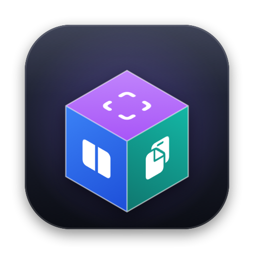

<p align="center"></p>

<p align="center"><a href="README.md">English</a> · <a href="README.ko.md">한국어</a> · <a href="README.ja.md">日本語</a> · <a href="README.zh-Hans.md">简体中文</a> · <b>繁體中文</b></p>

# PolyMac

> 眾多 Mac 工具，集於一個輕巧的選單列 App。
> 一款開源 macOS 工具，把 Spectacle · TRex · Snipaste · AppCleaner · Maccy · Hazel ·「在終端機中打開」**合併成一個輕巧的 App**。

> **目前版本 1.1.0** — 可從 [GitHub Releases](https://github.com/beomzh/PolyMac/releases) 下載，或用 Homebrew 安裝。
> 本頁為摘要版。快速鍵列表、各功能的詳細用法和疑難排解請參閱 [英文 README](README.md)。
> 部分功能是為韓文準備的（如韓文檔案名修復）。不需要時可以關閉。

## 功能

| 模組 | 功能 |
|---|---|
| **視窗佈局** | 用快速鍵將視窗排列為 ½、⅓、¼、最大化或移到下一個顯示器；拖到邊緣排列 |
| **截圖與固定** | 區域、視窗、全螢幕截圖，**固定在螢幕上**，可之後編輯的標註 |
| **文字辨識（OCR）** | 截圖後立即轉為文字放入剪貼簿；支援韓文、英文、日文、中文，以及 QR 碼、URL、表格辨識和本機翻譯 |
| **剪貼簿歷史** | 搜尋、固定，文字、影像和檔案；自動排除密碼管理 App |
| **Finder 工具** | 真正的 `⌘X` 剪下、在此處打開終端機、在編輯器中打開、複製路徑 |
| **韓文檔案名修復** | 自動修復被拆分（NFD）的韓文檔案名，適用於 Windows 的 zip |
| **下載自動整理** | 用條件加動作的規則移動和重新命名檔案（預設關閉） |
| **App 解除安裝** | 依位置、種類和可信度顯示 App 殘留檔案並移到垃圾桶 |

每個功能都可以在設定中開啟或關閉，關閉的功能不會載入記憶體。

## 顯示語言

在設定 › 語言 中可選擇：跟隨系統語言 / 한국어 / English / 日本語 / 简体中文 / 繁體中文，立即生效。「跟隨系統語言」使用 macOS 的偏好語言；如果該語言不在列表中，則使用英文。

文字辨識（OCR）先以韓文和英文讀取；如果沒有找到韓文，會自動判斷日文和中文（簡體、繁體）再讀取一次。

## 安裝

### 下載

從 [GitHub Releases](https://github.com/beomzh/PolyMac/releases) 下載 `PolyMac-X.Y.Z.zip` 和 `PolyMac-X.Y.Z.zip.sha256`，在兩者所在的資料夾中檢查檔案是否遭到竄改：

```bash
shasum -a 256 -c PolyMac-X.Y.Z.zip.sha256
```

顯示 `OK` 後解壓縮，把 `PolyMac.app` 移到 `/Applications` 再打開。

#### 首次打開被阻擋時

PolyMac 未經 Apple 公證，而是用自己的憑證（`PolyMac Beomzh`）簽署。因此首次打開下載的版本時會顯示 **「"PolyMac" 已損毀，無法打開」**。檔案並沒有損毀。如果你信任它，請在對話框中按 **取消**（不要丟到垃圾桶），然後在終端機中移除下載標記，再重新打開：

```bash
xattr -dr com.apple.quarantine /Applications/PolyMac.app
```

### Homebrew

```bash
brew tap beomzh/tap
```

```bash
brew trust --cask beomzh/tap/polymac
```

```bash
brew install --cask beomzh/tap/polymac
```

用 Homebrew 安裝時不會出現上面的「已損毀」對話框。

### 更新

選單列 PolyMac 圖示 › **檢查更新…** 會從 GitHub 安裝新版本，只安裝與 PolyMac 簽署金鑰（EdDSA）相符的版本。自動檢查（每天一次）可在設定 › 功能 › 更新 中開啟，預設關閉。

## 權限

PolyMac **只要求已開啟功能所需的權限**。首次啟動時會打開歡迎指南，也可隨時在設定 › 權限 中查看狀態。

| 權限 | 系統設定中的位置 | 使用的功能 |
|---|---|---|
| 輔助使用 | 隱私權與安全性 › 輔助使用 | 視窗佈局、Finder `⌘X`、自動貼上 |
| 螢幕與系統錄音 | 隱私權與安全性 › 螢幕與系統錄音 | 截圖、文字辨識 |
| 自動化 › Finder | 隱私權與安全性 › 自動化 | 打開終端機或編輯器、複製路徑 |
| 檔案與檔案夾 | 隱私權與安全性 › 檔案與檔案夾 | 韓文檔案名修復、自動整理 |

沒有權限時 App 照常執行，只有相關功能會保持關閉並給出提示。

## 隱私權與安全性

- **不連接網際網路。** OCR、翻譯、整理和剪貼簿全部在此 Mac 上處理，也不傳送使用統計。唯一的例外是你手動按下或開啟的 **更新檢查**（只取得新版本資訊，不傳送裝置資訊）。
- 按鍵只用於辨識快速鍵，不會儲存。
- **絕不永久刪除或覆寫檔案。** 刪除的內容都會移到垃圾桶。

詳見 [docs/SECURITY.md](docs/SECURITY.md)（英文）。

## 授權

PolyMac 採用 [MIT 授權](LICENSE)。為自動更新隨附的 [Sparkle](https://sparkle-project.org)（MIT）的版權聲明見 [THIRD_PARTY_NOTICES.md](THIRD_PARTY_NOTICES.md)。

PolyMac 與 Apple Inc. 無關，未獲得 Apple 的核准或贊助。Mac、macOS 和 Finder 是 Apple Inc. 的商標。

## 文件

其他文件以英文和韓文撰寫：[README（英文）](README.md) · [docs/ROADMAP.md](docs/ROADMAP.md) · [CONTRIBUTING.md](CONTRIBUTING.md) · [CHANGELOG.md](CHANGELOG.md)
